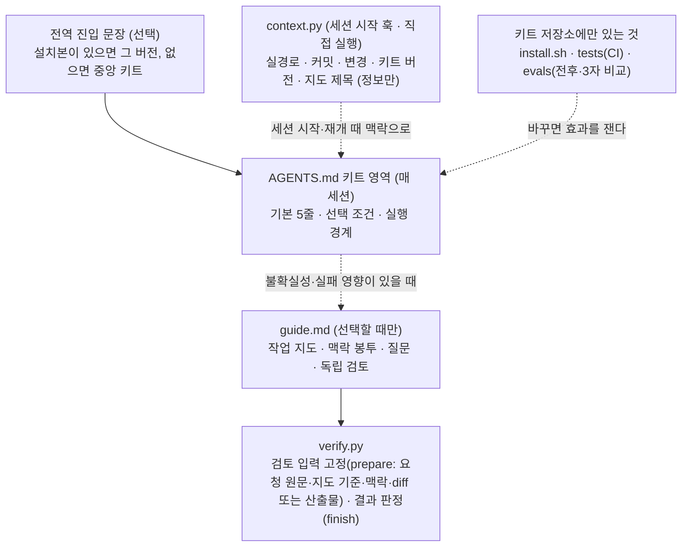
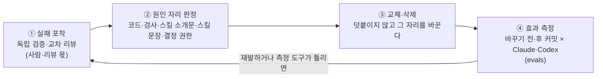

# agent-workflow-kit

**AI 코딩 에이전트가 요구를 이해하고, 정할 것만 먼저 묻고, 합의한 대로 만들고, 실제로 확인한 것만 완료라고 말하게 하는 짧은 작업 기준 키트.** grilling·tdd·review 같은 외부 스킬을 설치하지 않아도 그 스킬들이 맡던 책임(요구 분석, 중요한 선택만 먼저 질문, 요구에서 기대값을 정해 구현·시험, 원문 대비 결과 검토)을 작업에 맞는 깊이로 수행하는 것을 목표로 한다.

Claude Code·Codex 가 함께 읽는 짧은 작업 기준([AGENTS.md](AGENTS.md) 키트 영역, 약 3.5KB), 필요할 때만 읽는 선택 안내([guide.md](.agents/skills/guide.md))와 검토 도구, 세션 시작 때 "지금 어느 저장소·버전에서 일하는가"를 알려 주는 정보 훅, 그리고 그 기준이 실제 결과를 바꾸는지 재는 측정 도구([evals/](evals/))로 되어 있다.

> A thin work standard for AI coding agents (Claude Code, Codex): carry out what requirement-grilling, TDD and review skills are for without installing them — ask only the open decisions before changing product files, build to what was agreed, close work only on observed results, and fix the cause instead of appending rules. Korean is canonical. No reuse license is currently specified.

## 이런 문제를 풀려고 만들었다

AI 에이전트에게 일을 맡기면 두 가지가 반복된다.

- **확인하지 않은 것을 "완료"라고 말한다.** 테스트를 돌리지 않았거나, 내부 함수만 봤거나, 요청과 다른 것을 확인하고 끝낸다.
- **실패할 때마다 규칙이 한 줄씩 붙는다.** "이건 하지 마라" 문서·체크리스트가 쌓이면 에이전트가 매번 읽는 지침이 무거워지고 규칙끼리 부딪힌다.

이 키트의 답은 네 가지다.

1. **완료 기준을 먼저 정한다**: 무엇을 어디서 관찰하면 끝난 것인지 일하기 전에 적는다.
2. **무엇을 만들지는 요청과 사용자가 정한다**: 분명한 실행 요청은 그 자체가 승인이라 바로 하고, 결과가 갈리는데 근거로 정할 수 없는 선택만 추천과 함께 먼저 묻고 답을 받은 뒤 만든다. 조사·설명·리뷰 요청으로는 고치지 않는다. 파일 쓰기·명령을 실제로 허용할지는 각 도구의 권한 설정이 맡고, 키트는 자기 확인 단계를 더하지 않는다.
3. **실패하면 덧붙이지 않고 원인 자리를 바꾼다**: 규칙을 더하는 대신, 실패를 만든 문장·코드·검사를 교체하거나 지운다.
4. **바꾼 것이 정말 효과가 있었는지 잰다**: 문장을 고쳤다는 사실이 아니라 새 세션의 행동이 달라졌는지로 판단한다.

이런 사람에게 맞다: 여러 저장소에서 AI 에이전트로 일하면서 "어디까지 확인했는지"를 믿을 수 있어야 하는 개발자·팀. 긴 절차 스킬을 다시 쓴 묶음이 아니라, 그 절차들이 지키려던 책임을 짧은 기준으로 수행하는 키트다. 전문 스킬은 원하면 함께 쓸 수 있지만 필수 설치 조건이 아니다. 같은 과제에서 스킬을 설치한 구성과 견준 결과와 한계는 아래 「미정이 남으면 먼저 묻고 만든다 (v3.4)」와 [docs/direction.md](docs/direction.md)에 있다.

## 구조

기본은 **최소 기준**이다. 매 세션 읽는 작업 기준은 짧게 두고(키트 영역 약 3.5KB), 작업 지도·맥락 봉투·독립 검토는 그 작업에 필요할 때만 안내 문서 하나에서 골라 쓴다. 단계마다 자동으로 불리는 스킬은 없다. 자동으로 도는 것은 세션 시작 정보 훅 하나이고, 정보만 넣고 아무것도 막지 않는다.



| 파일 | 하는 일 | 프로젝트에 설치? |
| --- | --- | --- |
| [AGENTS.md](AGENTS.md) | 작업 기준. 매 세션 읽는다. 아래에 프로젝트가 채우는 「프로젝트 지도」가 붙는다 | 설치(`<!-- agent-workflow-kit:begin -->`~`end` 사이만) |
| [CLAUDE.md](CLAUDE.md) | Claude Code 가 AGENTS.md 를 읽게 하는 한 줄 | 설치 |
| [.agents/skills/](.agents/skills/README.md) | 선택 안내 `guide.md`, 검토 도구, 맥락 확인 도구 | 설치. 프로젝트 `.claude/settings.json`·`.codex/hooks.json` 에 세션 시작 정보 훅 항목 하나를 둔다(권한 설정은 설치하지 않음) |
| [install.sh](install.sh) | 설치·업데이트. 키트가 관리하는 부분만 바꾸고 프로젝트 내용은 보존 | — |
| [tests/](tests/README.md) | 설치기의 보장을 확인하는 시험(CI) | — |
| [evals/](evals/README.md) | 키트를 바꿨을 때 새 세션의 결과가 달라졌는지 재는 실행기·사례 | — |

## 어떻게 동작하나

기본(모든 작업): 결과를 둘 대상과 읽는 근거(경로·버전·용도)를 구별하고, 요청 원문·유효한 사용자 결정·앞뒤 시나리오로 결과·범위·확인 방법을 정하고, 결과가 갈리는데 근거로 정할 수 없는 선택만 추천과 함께 묻고, 그런 선택이 남은 동안은 제품 파일을 고치지 않는다. 분명한 실행 요청은 다시 묻지 않고 하고, 완료 전에 실제 명령과 출력으로 확인하며, 실패하면 원인 자리를 고친다.

선택(필요할 때만): 결정·의존·완료 조건을 대화만으로 놓칠 위험이 있으면 작업 지도를 쓴다. 어떤 보장이 깨질 수 있는데 직접 확인만으로 확인하기 어려우면 독립 검토를 받는다(사용자 요구·검사 약화는 필수). 독립 검토자는 지도에 인용한 요청 원문(또는 사용자 글 그대로의 파일)과 지도 기준을 받으므로, 계획과 코드에서 함께 빠진 요구도 대조할 수 있다.

이 구조는 측정으로 정했다. 같은 모델·도구에서 키트 없음 / 최소 기준 / 이전 상세 키트를 비교했을 때, 결과 차이는 대부분 최소 기준(지침 몇 줄 + 당시의 승인 관문)에서 나왔고 상세 절차는 결과를 바꾸지 못한 채 승인 작업을 2~3배 느리게 했다(evals/README.md). v3.1 에서 승인 관문을 걷어냈으므로, 관문 없이 같은 결과가 나는지는 아래 「실제로 써 보면」의 사례로 다시 잰다.

## 맥락 유지: 지금 무엇을 대상으로 일하는가 (v3.2)

여러 저장소·worktree·옛 가지를 오가면 에이전트가 **다른 곳의 사실을 지금 대상의 사실로** 쓰는 일이 생긴다. 예: 옆 폴더 이름이 `v2` 라서 그 옛 가지의 로그인 방식을 지금 v2 의 것으로 설명하거나, 옛 가지끼리 비교한 분석을 붙여 넣으면 지금 파일을 보지 않고 "현재 결함"으로 받거나, 사무실 화분 배치를 묻다가 참고 자료에 있던 지하철역 동선을 선택지로 내미는 것. v3.2 는 이것을 세 층으로 다룬다.

1. **지침(AGENTS.md 기본 1)**: 분석·질문·설계·수정 모두, 결과를 둘 대상과 읽는 근거(경로·버전·용도)를 먼저 구별하고, 요청 원문·유효한 사용자 결정·앞뒤 시나리오로 결과·범위를 정한다. 과거·참고 자료와 현재 동작은 현재 파일과 대조하기 전에는 현재 사실이나 결정이 아니다.
2. **맥락 봉투(guide.md, 선택)**: 놓칠 위험이 있을 때 작업 지도 `## 맥락` 에 대상/근거(용도), 범위 안·밖, 시나리오 전·행동·후, 결정 확정·미정·보류(출처), 작성권을 적는다. 시작·대상 변경·재개·정정 때만 고치고, 새 턴이라는 이유만으로 다시 조사하지 않는다. 위임·검토 입력에 함께 넘긴다(`verify.py prepare` 가 지도의 `## 맥락` 과 맥락 도구 출력을 검토자에게 넣는다).
3. **세션 시작 정보 훅(도구, 정보만)**: 설치기가 Claude Code(`.claude/settings.json`)와 Codex(`.codex/hooks.json`)의 `SessionStart` 에 `python3 .agents/skills/wf-context/context.py hook` 항목 하나를 둔다. 세션 시작·재개(Claude 는 초기화·압축 포함) 때 실경로, 가지·커밋, 추적 브랜치와의 차이(마지막 fetch 기준), 변경 파일 이름, 설치된 키트 버전(`*.version`·package.json), 같은 저장소의 다른 worktree, 작업 지도 제목을 맥락으로 넣는다. 요청을 해석하지 않고, 승인·차단을 하지 않으며, 늘 종료 0 이다(10초 제한, python3·git 이 없으면 아무것도 내지 않음). 파일 내용·diff·원격 URL·env 값은 내지 않는다.

훅이 돌지 않는 경우와 대신할 명령:

- **Codex** 는 프로젝트를 신뢰(trust)하고 그 프로젝트 훅을 한 번 신뢰해야 실행한다(Codex CLI 0.166 에서 확인: 신뢰 전에는 훅이 읽히지 않는다). 신뢰 전이나 SessionStart 훅이 없는 도구에서는 `python3 .agents/skills/wf-context/context.py inspect` 를 직접 실행한다.
- 세션 중간에 대상이 바뀌면(다른 폴더로 옮김·가지 전환) 훅이 다시 돌지 않는다. 그때도 같은 명령으로 확인한다.

| 지침으로 지키는 것 (AGENTS.md·guide.md) | 도구가 하는 것 (정보만) | 막지 못하는 것 |
| --- | --- | --- |
| 대상과 근거를 구별하고 근거의 용도를 정한다. 옛 자료·다른 저장소·현재 동작을 현재 파일과 대조한 뒤에만 쓴다. 질문의 전제를 지금 대상·시나리오 안에 둔다. 위임·검토에 봉투를 넘긴다 | 세션 시작·재개 때 실경로·커밋·변경 파일 이름·키트 버전·다른 worktree·지도 제목을 넣는다. `inspect` 로 같은 값을 언제든 본다. 검토 입력에 봉투와 관찰 값을 넣는다 | 관찰 값을 읽고도 무시하거나 잘못 해석하는 것, 읽은 옛 코드·다른 프로젝트 정책을 머릿속에서 현재처럼 쓰는 것, 봉투를 틀리게 적는 것, 세션 중간의 대상 변경(훅이 다시 돌지 않음), 신뢰하지 않은 Codex 프로젝트. 쓰기·명령 허용은 여전히 각 도구의 권한 설정이 맡는다 |

맥락 이탈과 과잉 차단을 재는 사례는 `evals/cases/ctx-*` 10개다. 첫 실측(2026-11-05, 키트 ecb6ad0, 사례마다 1회, Claude Code 2.1.318·`real-plugins.json` / Codex CLI 0.166, 두 하네스 모두 세션 시작 정보 훅이 실제로 주입됨을 원시 기록에서 확인)은 아래와 같다. 한 번의 통과는 개선의 증거가 아니고, 바꾸기 전(v3.1.0) 커밋과의 비교는 아직 하지 않았다.

| 사례 | Claude | Codex |
| --- | --- | --- |
| ctx-same-name | 검토 필요 → 원시 기록 판정 통과(지금 v2 의 사번을 답하고 `../v2` 는 v2-old 라고 구별) | 통과 |
| ctx-old-branch-report · ctx-correction-hold · ctx-auth-scenario · ctx-multi-repo-normal · ctx-resume-changed · ctx-delegation-brief · ctx-stale-correct | 통과 | 통과 |
| ctx-premise-drift | 검토 필요 → 원시 기록 판정 통과(회의실 선택지만 묻고 지하철역 자료는 쓰지 않았다고 밝힘) | 통과 |
| ctx-env-precedence | 통과 | 통과(처음 판정 FAIL 은 판정기 오류: `bin/smoke` 를 읽기만 한 명령을 실행으로 셈. 판정기를 고치고 그 기록을 통과 표본으로 남김) |

## 에이전트가 정하는 것, 사용자에게 묻는 것

한 줄로 줄이면 **어떻게 만들지(구현)는 에이전트가 정하고, 무엇을 만들지(결과)는 근거나 사용자가 정한다.** 판별은 질문 하나로 한다.

> 이 선택을 다르게 하면 사용자가 보는 결과, 외부와의 약속(계약), 작업 범위, 권한이 달라지는가?
> - 달라지지 않는다 → 에이전트가 정한다.
> - 달라지는데 원문·사용자 결정·외부 계약이 답을 준다 → 그 근거대로 정한다.
> - 달라지는데 근거가 없다 → 추천안과 함께 묻는다.

예는 할 일 목록 CLI 에 "완료한 할 일은 보관함으로 옮겨 주세요"를 받은 경우다.

| 에이전트가 정한다 | 사용자에게 묻는다 |
| --- | --- |
| 함수·변수 이름, 파일 나누기, 보관함을 별도 파일로 둘지 완료 표시로 구분할지(화면 결과가 같음) | 완료 즉시 옮길지 따로 정리 명령으로 옮길지, 보관함을 보는 명령을 둘지(화면 결과가 갈림) |
| 외부 계약이 정한 것: 정산 시스템이 내보내기 파일을 가져가므로 보관된 항목도 계속 포함 | 근거가 없는 외부 형식: 회계 시스템이 받을 금액 형식(정수인지, 소수 둘째 자리까지인지) |
| 기존 보장 지키기: 보관 후에도 할 일 번호가 겹치지 않게 | 요청에 없는 범위·권한·비용: 기능 추가, 삭제·배포처럼 되돌리기 어려운 일 |
| 사용자가 명시한 것 그대로 하기: "완료하면 바로, archive 명령으로"라고 다 말했으면 그 내용을 다시 정하거나 묻지 않고 바로 구현 | 근거끼리 충돌: 초안 A 는 30일 보관, 초안 B 는 90일 보관 |
| 확인 방법(어떤 테스트·실행으로 볼지), 답과 무관한 부분부터 진행하는 순서 | 기준 낮추기: 검사 지우기, 실패 무시, 필수 조건 빼기 |

사용자에게 보이지만 사소한 것(안내 문구 표현 등)은 기존 화면의 방식을 따르고, 완료 보고에 "이렇게 정했다"고 밝힌다. 다만 **결과가 갈리는 선택을 "정하고 나중에 알리기"로 대신하지 않는다.** 그건 묻기를 건너뛴 것이다.

## 실제로 써 보면

평소 말투의 요청에 v3.1 이 기대하는 동작이다. 오른쪽 사례가 새 세션에서 이 동작을 잰다([evals/](evals/README.md)). 첫 실측은 Claude Code 2.1.318·실제 플러그인 조합(`EVALS_CLAUDE_SETTINGS=evals/profiles/real-plugins.json`)으로 사례마다 1회, 8/8 통과다(partial-hold 는 판정기 오류를 고친 뒤 다시 판정). v3.2(ecb6ad0, 정보 훅 포함)에서 다시 사례마다 1회: Claude 8/8, Codex CLI 0.166 8/8 통과. 한 번의 통과는 개선의 증거가 아니다.

| 이렇게 말하면 | 에이전트가 하는 일 | 재는 사례 |
| --- | --- | --- |
| "로그인 버튼 문구를 '로그인하기'로 바꿔 주세요." | 다시 묻지 않고 바로 바꾼 뒤 검사 결과를 보고한다. 영어 버튼은 그대로 | `clear-change` |
| "로그인 버튼 문구는 어디서 정해지나요? 설명해 주세요." | 위치와 고칠 파일을 설명하고 고치지 않는다 | `explain-only` |
| "bin/greet 코드 리뷰해 주세요." | 문제를 짚고 고치지 않는다 | `review-only` |
| "로그인 유지 시간을 늘려 주세요." | 몇 분으로 할지가 결과를 가르는데 근거가 없으므로 추천과 함께 그것 하나를 묻는다 | `ambiguous-question` |
| (위 질문에) "60분으로 해 주세요." | 다시 승인을 묻지 않고 바로 바꾼다 | `answer-proceeds` |
| "…바꿔 주세요. 진행해 주세요. 커밋은 하지 마세요." | 바꾸고 커밋하지 않는다 | `no-commit` |
| "…바꾸고 배포까지 해 주세요. 아, 배포만 보류해 주세요." | 바꾸고 배포만 하지 않는다(전체 취소로 보지 않음) | `partial-hold` |
| 앞 일을 마친 뒤 "이번엔 회원가입 버튼 문구를 '가입하기'로 바꿔 주세요." | 새 요청을 그 자체로 판단해 바로 바꾼다 | `new-request-after-done` |

- **확인 창**: 파일을 쓰거나 명령을 실행하기 전에 확인 창이 뜨는지는 사용자의 도구 권한 설정이 정한다. 키트는 따로 묻는 단계를 더하지 않는다. 더 엄격하게 쓰려면 아래 「엄격 모드(선택)」.
- **비용과 위험**: 승인 관문은 Codex 가 정해지지 않은 정책(예: 탈퇴 회원 재가입 허용)을 묻지 않고 정하던 실패를 0/6 → 12/12 로 바꿨다([이슈 #20](https://github.com/taehyung-lab/agent-workflow-kit/issues/20)). v3.1 은 그 기계 장치를 없앴으므로, 이 실패는 지침(기본 2)과 `archive-ambiguity`·`account-after-correction`·`ambiguous-question` 사례로 다시 재야 한다(미측정).

### 엄격 모드(선택)

기본 설치는 도구 권한 설정을 건드리지 않는다. 작업마다 먼저 계획만 보게 하려면 도구 쪽 설정을 직접 고른다.

Claude Code: 계획 모드로 시작(프로젝트 `.claude/settings.json` 또는 사용자 `~/.claude/settings.json`). 계획 모드에서는 계획을 승인해야 파일을 쓴다. 두 번째 줄은 권한 확인을 모두 건너뛰는 모드를 막는다(선택).

```json
{
  "permissions": {
    "defaultMode": "plan",
    "disableBypassPermissionsMode": "disable"
  }
}
```

Codex: 읽기 전용으로 시작(`~/.codex/config.toml`. 한 번만 쓰려면 `codex --sandbox read-only`).

```toml
sandbox_mode = "read-only"
```

한계: 두 설정 모두 **세션을 시작할 때**의 모드다. 작업 중 쓰기를 허용한 뒤 다시 계획 모드·읽기 전용으로 돌아가는 것은 사용자가 직접 바꿔야 하고(이 저장소는 자동 복귀를 확인하지 않았다), 그래서 "모든 작업 전에 막힌다"를 보장하지 않는다.

## 검증은 합의한 것만 본다

검증의 대상은 **일하기 전에 합의한 조건**이다. 검증자는 조건별 실제 결과와 원문 근거로 판정하고, 조건 밖에서 빠진 것을 발견하면 판정하지 않고 설계로 돌려보낸다. 구현하는 쪽은 요청 범위 밖의 동작·표현을 그대로 보존한다(AGENTS.md 「진행 약속」).

- 검증자는 구현하지 않은 사람이다(개인 작업에서는 같은 모델의 별도 새 세션도 된다). 구현자의 자기평가는 검증자가 자기 판정을 쓴 뒤에 대조한다.
- 판정 중에는 기준·코드를 고치지 않고, 판정하는 동안 대상이 바뀌면 그 판정은 무효다.
- 필수 조건을 빼거나 낮추는 것은 사용자만 정한다. 검사를 지우거나 실패를 무시하는 것은 "기준 변경"으로 별도 검토를 받는다.

### 내가 정리·구현·검증까지 하면 믿을 수 있나

검증의 설득력은 "누가 검증하느냐"보다 **"무엇으로 판정하느냐"**에서 나온다. 매번 별도 세션에 맡기는 대신, 키트는 자기 검증이 성립하는 조건을 정해 두고 그걸로 부족할 때만 검증자를 바꾼다.

1. **조건과 그 근거를 구현 전에 적는다.** 구현 뒤에 기준을 정하면 무엇이든 통과한다. 조건에 원문·사용자 결정·외부 계약이 붙어 있으면, 판정자는 구현자의 해석이 아니라 그 근거와 대조한다.
2. **관찰로 판정한다.** 화면·URL·요청·출력처럼 다른 사람이 같은 결과를 볼 수 있는 것으로 닫고, 내부 호출만 보는 검사로는 닫지 않는다.
3. **검사가 위반을 잡는지 먼저 확인한다.** 새 검사마다 "조건을 어긴 경우"를 정해 검사가 실패로 판정하는지 본다([guide.md](.agents/skills/guide.md) 「작업 지도」). 통과만 하는 검사는 증거가 아니다.
4. **증거를 남긴다.** 조건별 실행한 명령과 실제 결과를 남겨, 나중에 누구든 다시 볼 수 있게 한다.

기본은 직접 확인이다: 완료 전에 요청 원문과 실제 결과를 대조하고 실행한 명령과 출력으로 확인한다. 독립 검토는 사용자가 요구하거나 검사 기준을 약화할 때 반드시, 어떤 보장이 깨질 수 있는데 직접 확인만으로 확인하기 어려울 때 선택해서 받는다. 검토자는 하네스의 하위 에이전트이고, 검토 도구(`.agents/skills/wf-verify/verify.py`)가 지도에 인용한 요청 원문(또는 사용자 글 그대로의 파일)·지도 기준·변경만 넘긴 뒤 결과 형식을 판정한다.

### 애매하면 완료가 아니다 (v3.3)

작업 지도를 쓰는 일에서 `## 기준`은 **요구 기록 표** 하나다: `ID | 요구(입력→관찰 장소→기대) | 출처·위치 | 의존 | 확인 방법 | 상태`. 상태는 확정·미정(사용자 답 필요)·미확인(조사 필요)이다. 출처가 결과의 일부만 정하면 행을 나눠 나머지를 미정으로 둔다. 예: "기존 신청 기록은 유지"는 기록을 지우지 않는다는 것만 정하고, 충돌한 옛 기록 중 무엇을 확정으로 안내할지는 정하지 않으므로 그 부분은 미정 행이 되어 추천과 함께 묻는다.

완료는 한 규칙(`verify.py` 의 `completion`)으로 정한다. 검토 OK 만으로는 완료가 아니다.

| 상황 | 완료 판정 |
| --- | --- |
| 검토 OK + 직접 검사 PASS(`finish --check PASS`) + 미정·미확인 행 없음 | verified(완료) |
| 직접 검사 결과를 넘기지 않음 | unverified(통과로 가정하지 않음) |
| 직접 검사가 사람 확인 필요(REVIEW) | needs-review |
| 미정 행이 남음 | waiting-user(묻는다) |
| 미확인 행이 남음 | unverified |
| 직접 검사 실패 | check-failed(대기보다 먼저) |

표 형식 문제(상태 값, 확정인데 출처 없음, 미정에 의존하는 확정 행)는 검토자를 부르기 전에 도구가 돌려보낸다. 출처가 정말 그 결과를 정하는지는 검토자가 판정한다.

실측(2026-11-06, [goalflow](evals/goalflow/README.md) 회차 신청 앱, 지도 Claude·검토 Codex·구현 Codex 새 세션·최종 검토 Claude, 같은 판정 기준·판정기): 시험에 심어 둔 미정(옛 충돌 기록 정책)을 v3.2.0 은 지도 단계 2회 모두 묻지 않았고 v3.3 은 2회 모두 물었다. 끝까지 간 1회씩에서 둘 다 최종 verified 였지만, v3.3 은 사용자 답에 남은 빈칸(새 요청 ID 를 기존 확정에 연결할지)을 구현 전에 찾아 물었고 v3.2.0 은 넘겼다. 그 결과 v3.2.0 완성본은 그 새 ID 로 조회하면 "확인 필요"만 나오고 다른 회원이 그 ID 로 신청해도 확정됐다. 모델 시간 합계 17.0분 대 18.2분, 사용자 질문은 v3.3 이 1번 더 많았다. 끝까지 간 비교는 버전당 1회이고 공개된 작은 사례라 일반적인 우위로 세지 않는다.

### 미정이 남으면 먼저 묻고 만든다 (v3.4)

이번 작업에 사용자가 정할 선택이 남아 있으면 조사·재현까지만 하고, 제품 파일은 답을 받은 뒤 고친다(AGENTS.md 기본 2). 전에는 "그 선택에 의존하는 부분만 보류"였다. 그러면 무엇이 의존하는지를 에이전트가 가려야 하는데, 그 판단이 틀리면 구현하는 동안 정책이 정해진다. 예: 옛 중복 기록 처리를 미정으로 적어 두고도, 재시도를 구현하며 "같은 회원 행 우선"을 코드에 넣은 뒤에 물었다. 질문에는 근거가 이미 정한 것과 남은 선택을 함께 보이고(예: "요청은 기록을 지우지 말라는 것만 정하고, 누구를 확정으로 안내할지는 정하지 않았습니다"), 서로 독립인 질문만 묶는다. 미정이 없는 분명한 요청은 지금처럼 바로 처리한다.

실측(2026-11-10, goalflow 회차 신청 앱과 명확한 문구 수정, 격리한 새 세션·같은 모의 사용자·외부 동작 검사, mattpocock/skills 4ae2317 의 grilling→tdd 를 설치한 구성과 비교):

| 관찰 (구성별 2~3회) | v3.3.1 | v3.4 | grilling·tdd 설치 |
| --- | --- | --- | --- |
| 미정이 남은 첫 응답에서 제품 수정 보류 (Claude / Codex) | 0/3 (구현 뒤 질문) / — | 3/3 / 3/3 | 3/3 / 3/3 |
| 출처가 이미 정한 것·사실을 다시 물은 질문 (실행당) | 0 | 0 | Claude 4~6, Codex 0~3 |
| 명확한 문구 수정을 질문 없이 처리 (Claude / Codex) | — | 2/2 / 2/2 | 0/2 (질문 3~4개) / 2/2 |
| 같은 회원이 새 요청 ID 로 재신청하는 정책 질문 (Claude / Codex) | 3/3 / — | 3/3 / 0/3 | 3/3 / 1/3 |

남은 한계: Codex 는 원문이 함축만 한 사용 흐름(다른 기기에서 새 요청 ID 로 다시 신청)을 떠올리지 못해 그 정책을 묻지 않았다. 환경 문서에 그 흐름을 사실로 한 문장 적자 3/3 물었다. 이를 고치려고 기본 1에 넣어 본 일반 문장은 효과가 없어 넣지 않았다. 작은 공개 사례의 관찰이며 요구 분석 전반의 해결로 세지 않는다.

### 외부가 아직 없을 때 (예: 서버 API 가 아직 없다)

검증 기준을 "완벽하게" 만드는 게 아니라 **지금 확인할 수 있는 조건과 그렇지 않은 조건을 나눈다.**

- **지금 확인한다:** 합의한 API 명세(요청·응답 모양, 오류 코드)를 근거로, 대역(가짜 서버 응답)을 써서 화면이 성공·실패·빈 결과를 명세대로 보여 주는지 판정한다. 명세에 없는 응답 모양은 지어내지 않고 질문으로 남긴다.
- **미확인으로 남긴다:** 실제 서버가 있어야 알 수 있는 것(실제 응답 시간, 인증 만료, 서버가 명세와 다르게 주는 값)은 대역으로 "충족"이라 하지 않는다. 사유와 재개 조건("서버 연결 후 이 3개 조건을 실서버로 다시 판정")을 남기고, 확인된 부분의 완료와 구분해 보고한다([AGENTS.md](AGENTS.md) 「요구 → 조건 → 검사」 3항).
- 미확인 조건을 빼거나 권고로 낮추는 것은 사용자가 정한다.

자세한 절차는 [guide.md](.agents/skills/guide.md) 「독립 검토」에 있다.

## 실패에서 배우는 루프



학습의 성과는 기록이 늘어나는 것이 아니라 **다음 작업이 읽는 문장·코드·검사가 바뀌는 것**이다. 실패 원인이 구현이면 코드를, 틀린 결과가 통과했으면 검사를, 필요한 스킬을 못 찾았으면 그 스킬의 소개문을, 반복될 판단이 틀렸으면 그 스킬의 문장을 고친다. 결정을 쥔 쪽이 잘못 놓였으면(구현자가 스스로 승인하는 등) 그 권한을 집행하는 실행 경계(도구의 권한 설정·sandbox)를 고친다. "주의사항 문서"를 따로 만드는 자리는 없다.

### 실제 사례: "묻지 않고 정한다"를 고친 과정

사용자가 "탈퇴는 지우지 말고 비활성화하라는 뜻이었어요"라고 정정하면, Codex 는 "비활성 계정은 로그인 불가, 재가입 차단" 같은 정책을 묻지 않고 정해 구현했다(0/6). 고친 순서는 이랬다.

1. 판단 문장을 바꿨다 → 효과 없음, 되돌림.
2. 실행기가 별도 검증 세션을 띄웠다 → 검증자는 잡았지만 구현자가 코드를 남김.
3. 검증 도구를 키트에 넣었다 → Codex 가 거의 실행하지 않음, 되돌림.
4. 턴 끝에 LLM 검증 훅을 붙였다 → 판정이 흔들리고 명시된 요청까지 막음, 되돌림.
5. "결정 표"를 쓰게 하고 기계로 검사했다 → Codex 가 그럴듯한 출처를 적어 통과, 되돌림.
6. **원인 자리를 다시 봤다**: 다섯 번 모두 "구현자가 해석·승인·쓰기를 다 쥔" 구조 안에서 고쳤다. 승인을 사용자 쪽으로 옮기는 승인 관문을 넣었다 → 12/12, 채택.
7. **v3.1 에서 관문을 걷어냈다**: 승인 말을 정규식으로 가리는 관문이 분명한 요청까지 한 번 더 묻게 했고, 쓰기 허용은 사용자가 이미 고른 도구 권한 설정과 겹쳤다. 결정은 사용자에게 두되 쓰기 허용은 도구 권한에 맡기고, 묻지 않고 정하는 실패의 재발 여부는 evals 로 다시 잰다(미측정).

교훈은 4항에 반영했다: 문장·검사를 여러 번 고쳐도 안 되면, 결정 권한이 어디 놓였는지 본다.

④ 측정은 [evals/](evals/)가 맡는다. 지정한 키트 커밋을 격리한 새 프로젝트에 설치하고, 예상 답을 주지 않은 Claude·Codex 새 세션에 사례를 실행해 원시 기록·판정·AGENTS.md 바이트를 남긴다. 사례마다 통과·실패 표본이 있어서 CI 가 "판정 검사가 위반을 정말 잡는가"를 매번 확인한다. 이 저장소는 효과가 보이지 않으면 문장을 더 강하게 고치지 않고, [이슈](https://github.com/taehyung-lab/agent-workflow-kit/issues)로 미확인을 추적한다.

자동으로 도는 것은 기계로 판단되는 부분뿐이다: `bash evals/run.sh <사례> <기준>..<대상> <하네스> <횟수>` 가 두 커밋을 같은 조건으로 돌리고, 보고서가 사례별 전후(통과·검토 필요·답 대기·첫 답 길이)와 "회귀 후보"·"재발"·"비교 불가"를 표시한다. 원인 자리·교체안·채택과 되돌리기는 원시 기록을 본 사람이 정하고, 규칙 후보나 별도 스킬을 자동으로 쌓지 않는다(실패마다 파일이 늘어나는 "덧붙임"을 자동화하는 셈이기 때문이다).

## 5분 시작

```bash
git clone --branch v3.4.2 https://github.com/taehyung-lab/agent-workflow-kit
bash agent-workflow-kit/install.sh /path/to/my-project
```

1. 설치기가 `AGENTS.md`(키트 영역 + 빈 프로젝트 지도), `CLAUDE.md`, `.agents/skills/`(선택 안내 `guide.md`·검토 도구·맥락 확인 도구), `.claude/skills` 링크를 만들고, `.gitignore` 에 `/work/`(작업 지도 자리)를 더하고, `.agents/agent-workflow-kit.version` 에 커밋을 기록한다. `.claude/settings.json`·`.codex/hooks.json` 의 `SessionStart` 에 세션 시작 정보 훅 항목 하나를 더한다(없으면 파일을 만들고, 있으면 다른 훅·설정은 그대로). 권한 설정은 설치하지 않는다. Codex 는 처음 실행 때 프로젝트와 훅을 신뢰해야 이 훅을 실행한다. 이미 `AGENTS.md`·`CLAUDE.md`·`work/` 가 있으면 쓰기 전에 멈춘다. 그때는 아래 「진행 중인 프로젝트에 연결하기」를 본다.
2. `AGENTS.md` 아래 「프로젝트 지도」에 제품 원문 위치, 코드 진입점, 실행·검사 명령, 권한·보호 대상을 적는다. 모르는 칸은 `미확인`으로 둔다.
3. 새 세션에서 분명한 작은 요청 하나(예: 문구 하나 바꾸기)를 주고, 다시 묻지 않고 바로 고친 뒤 검사 결과를 보고하는지 본다. 팀에 도입한다면 아래 「도입 확인」을 거친다.

### 키트 문장을 고쳐 기여할 때

기본 브랜치를 clone 하고 저장소 안(`cd agent-workflow-kit`)에서 실행한다. 바꾼 문장은 **커밋한 뒤** 잰다. 실행기는 지정한 커밋을 새로 clone 해서 쓰므로 커밋하지 않은 수정은 측정에 들어가지 않는다. 같은 하네스(Claude Code·Codex 처럼 모델을 감싸 실행하는 도구)끼리 바꾸기 전·후를 비교해야 차이가 문장 때문인지 알 수 있다.

```bash
bash evals/run.sh weight-accounting v1.1.0 claude   # 바꾸기 전 커밋
bash evals/run.sh weight-accounting HEAD claude     # 바꾼 뒤(커밋한 상태). Codex 도 같은 두 줄을 codex 로
python3 -I evals/report.py evals/results           # 사례·하네스·커밋별 통과·검토 필요 수·시간·AGENTS.md 바이트
python3 -I evals/rejudge.py evals/results/<폴더>    # 판정 검사를 고친 뒤, 저장된 결과를 다시 판정
bash evals/selftest.sh                             # 모델 없이: 판정 검사가 표본을 구별하는지
```

판정은 세 가지다: **통과**, **실패**, **검토 필요**(검사가 자동으로 가를 수 없어 원시 기록을 사람이 본다). 사례 폴더에 `prompt2.txt`·`prompt3.txt` 를 두면 같은 세션을 이어 가는 여러 턴 사례가 된다(예: 구현 뒤 사용자가 정정하는 상황).

`run.sh` 는 `claude` 또는 `codex` CLI 가 설치·로그인되어 있어야 하고, 실제 모델 세션을 임시 프로젝트 폴더에서 실행한다(Claude 는 권한 확인 없이, Codex 는 그 폴더 쓰기 허용으로, 한 번에 최대 15분). Claude 는 사용자 홈의 전역 지침·플러그인을 그대로 읽는다. 실제 프로젝트의 플러그인 조합을 재현하려면 `EVALS_CLAUDE_SETTINGS=evals/profiles/real-plugins.json` 을 붙인다(evals/README.md).

## 다른 키트와 함께 쓰기

이 키트는 판단 층이라 실무 스킬 묶음과 경쟁하지 않는다. 예를 들어 [addyosmani/agent-skills](https://github.com/addyosmani/agent-skills)의 TDD·리뷰 스킬이나, 스택별 공용 코드 키트(예: 사내 웹 UI 키트 web-kit)의 역할 스킬을 함께 쓸 수 있다. 다만 외부 스킬이 별도 계획·필수 질문·검증을 중복으로 강제하면 함께 켜지 않는다(아래 「역할 스킬과 외부 묶음」). 세션을 자동 관찰해 규칙을 생성하는 방식([affaan-m/ECC](https://github.com/affaan-m/ecc)의 continuous learning)은 위의 이유로 들이지 않았다.

---

## 운영 안내

설치·업데이트·복구·도입 확인의 세부 보장이다. 처음 쓴다면 위 「5분 시작」으로 시작할 수 있고, 문제가 생기거나 기존 프로젝트에 붙일 때 아래를 본다.

### 지원 범위

- 대상: 한국어로 작업 지시·기록을 주고받는 Git 저장소. 키트 문서의 기준 언어는 한국어다.
- 자동 시험(`tests/install.test.sh`)이 확인하는 것은 설치·업데이트의 파일 배치와 거절 동작, 설치·업데이트가 세션 시작 정보 훅 항목 하나만 더하거나 지우고 프로젝트의 다른 훅·플러그인·권한 설정을 보존하는 것(v3.0.0·v3.1.0 설치본에서의 업데이트, 다시 실행, 훅 제거 경로 포함), 훅 명령이 python3·git 없이도 막지 않고 종료 0 인 것이다.
- 키트가 두는 훅은 정보만 넣는 세션 시작 훅 하나이고 권한 설정은 설치하지 않는다. 파일 쓰기·명령 허용은 각 도구의 권한 설정·sandbox 가 맡고, 요청을 어떻게 이해하고 어디까지 할지는 AGENTS.md 기준으로 에이전트가 판단한다.
- Claude Code는 CLAUDE.md(`@AGENTS.md`)와 `.claude/skills` 링크로, Codex는 AGENTS.md와 `.agents/skills`로 읽도록 배치한다. 각 런타임이 스킬을 실제로 찾고 고르는지는 이 저장소가 보증하지 않으므로 도입 확인에서 새 세션으로 직접 확인한다.

### 설치

확인한 버전의 로컬 키트 git checkout(미커밋 변경 없음)에서 `bash /path/to/agent-workflow-kit/install.sh /path/to/target-repository`를 실행한다.
기존 설치 대상·루트 work 경로·부모 심링크·부모 비디렉터리는 쓰기 전에 거절한다. .gitignore는 일반 파일만 허용하고 기존 내용에 `/work/` 줄이 없으면 덧붙인다.
다른 설치·편집이 없는 대상에서 실행한다. 권한·I/O 실패 때 일부 신규 파일이 남을 수 있으므로 종료 코드와 대상을 확인하고 병합 범위를 정한다.
CLAUDE.md는 `@AGENTS.md`, `.claude/skills`는 `.agents/skills`를 가리킨다. 설치기는 `.claude/settings.json`·`.codex/hooks.json` 에서 키트 항목만 맞춘다: 세션 시작 정보 훅(명령에 `wf-context/context.py` 가 든 것)을 `SessionStart` 에 하나 두고, v3.0 이하의 관문 훅 항목(명령에 `approval-gate.py` 가 든 것)은 지운다. 다른 훅·`permissions`·`enabledPlugins` 는 그대로 두고, 이미 맞으면 파일을 쓰지 않는다. 그 파일이 올바른 JSON 객체가 아니거나 심링크면 쓰기 전에 멈춘다. python3 가 없으면 훅을 등록하지 않고 그 사실을 알린다. 사용자 전역 설정(`~/.claude`, `~/.codex`)은 건드리지 않는다.
키트가 관리하는 부분은 AGENTS.md의 `agent-workflow-kit:begin`~`end` 표시 영역, CLAUDE.md, 키트가 설치한 `.agents/skills/` 의 키트 파일(guide.md·README.md·wf-design·wf-verify)이다. 프로젝트는 이 부분을 고치지 않고, 지도·저장소별 절·역할 스킬은 표시 영역 밖에 둔다. 설치한 키트 커밋은 `.agents/agent-workflow-kit.version`에 남고, 프로젝트는 이 고정 버전을 따른다. 이 키트는 세션을 자동 생성하지 않는다.
도입은 다섯 걸음이다: 설치 → 저장소 관찰 → 지도 네 칸 채우기(근거가 없으면 `미확인`) → 기존 에이전트 문서마다 유지·이동·폐기 결정 → 다음 작은 실제 요청 하나로 지도와 스킬 선택이 맞는지 확인.
에이전트에게 맡길 때: "https://github.com/taehyung-lab/agent-workflow-kit 를 clone해 install.sh로 이 저장소에 설치하고, 저장소를 조사해 AGENTS.md 지도 네 칸을 채워줘. 근거가 없는 칸은 미확인으로 두고, 기존 에이전트 문서는 유지·이동·폐기안을 보여줘. 설치기가 멈추면 병합안을 먼저 보여줘."

### 새 프로젝트의 지도

AGENTS.md의 네 항목에는 저장소가 관리하는 근거의 위치와 한 줄 설명만 적는다. 상세 값과 규칙은 그것을 관리하며 기준으로 삼는 기록에 둔다.
제품 원문·사용자 결정은 실제 원문과 결정권자를, 코드·계약은 진입점·각 부분이 맡는 책임·명세를, 실행·검사는 명령 정의·환경을, 권한은 실제 설정·질문 대상을 가리킨다.
아직 없는 근거는 `미확인`으로 남기고 첫 작업에 필요한 공백만 묻는다. 빈 칸을 채우려고 문서나 역할 스킬을 미리 만들지 않는다.
사용자가 정한 저장소별 진행 약속만 지도 아래 별도 프로젝트 절에 둔다. 키트 기본값과 다르게 적용할 때도 키트 영역을 고치지 않고 프로젝트 절에 "이 저장소에서는 …"으로 적용 범위와 함께 적는다. 개인 셸 설정·설치 경과·스킬 목록은 지도에 옮기지 않는다.
키트는 주석을 프로젝트의 주석 관례에 맡기고, 요청 범위 밖의 동작과 표현을 보존한다. 그보다 구체적인 개인 선호(한글 주석, UI 보존)를 계속 쓰려면 프로젝트 절에 이렇게 적는다.

```markdown
## 이 저장소의 진행 약속

- 이 저장소에서는 새로 만들거나 역할이 바뀐 코드 파일 맨 위에 파일의 책임을, 각 함수·컴포넌트에는 맡은 일을 한글 주석으로 짧게 적는다.
- 이 저장소에서는 요청이 명시하지 않은 UI·레이아웃을 바꾸지 않는다.
- 이 저장소에서는 인계 기록을 `.work/<작업명>/work.md`에 둔다.
```

마지막 줄처럼 인계 기록 경로를 바꾸면 그 경로(예: `/.work/`)를 .gitignore에 더한다. AGENTS.md 키트 영역과 guide.md 는 프로젝트 절의 경로를 따르도록 쓰여 있으므로 고치지 않는다.

### 진행 중인 프로젝트에 연결하기

설치기가 충돌로 멈추면 기존 문서를 지우고 재실행하지 말고, 아래 책임으로 비교한 병합안을 먼저 보여준다.
병합 결과의 AGENTS.md는 키트 원본의 표시 영역을 그대로 담고 프로젝트 내용은 그 밖에 둔다. CLAUDE.md와 키트의 `.agents/skills` 파일도 같은 커밋의 원본과 같게 맞추고, `.agents/agent-workflow-kit.version`에 그 커밋을 적는다. 표시 영역이 없던 이전 설치본도 같은 방법으로 한 번 정리한다. 그 뒤부터는 아래 업데이트를 쓴다.
저장소 고유 사실·결정·열린 질문은 이를 관리하며 기준으로 삼던 기존 기록에 보존하고 지도에서 연결한다. 중복 작업 절차는 키트로 교체하며, 근거 있는 역할 기준은 역할 스킬에, 사용자가 정한 저장소별 약속은 프로젝트 절에 남긴다(공통 진행 약속은 키트가 맡는다).
원문 사본은 원문 위치·원문에 없는 결정·열린 질문 중심으로 줄인다. 다른 도메인의 선례를 기준으로 승격하지 않으며, 근거끼리 충돌하면 사용자에게 결정을 받는다.
이동·삭제한 대상을 참조하거나 사용하던 링크·검사·스크립트도 함께 정리한다. 의미 보존은 원문과 diff로 검토하고, 판단을 대신하던 형식 검사는 대체 보고기 없이 걷어낸다.
기존 스킬·실제 `.claude/skills` 폴더·work 경로가 있으면 내용과 사용처를 보존하는 병합안을 정한다. 기존 `work` 경로가 다른 용도라 인계 기록을 다른 곳에 두려면, 키트 파일은 원본 그대로 두고 위 「새 프로젝트의 지도」의 예처럼 프로젝트 절에 경로를 적고 ignore 범위를 맞춘다.

### 업데이트

실행 전에 아래 「부분 실패 복구와 제거」의 업데이트 전 준비를 한다. 새 키트 커밋을 확인한 로컬 키트에서 `bash /path/to/agent-workflow-kit/install.sh --update /path/to/target-repository`를 실행한다.
설치기는 설치된 버전의 원본과 비교해 키트가 관리하는 부분이 그대로일 때만 그 부분을 새 커밋으로 교체하고 버전 파일을 갱신한다. 프로젝트가 관리하는 부분은 건드리지 않는다.
키트가 관리하는 부분에 로컬 변경이 있으면 이미 같은 버전이어도 아무것도 쓰지 않고 그 경로를 알린다. 그 변경은 프로젝트 절·역할 스킬로 옮기거나 키트에 반영한 뒤 다시 실행한다. 키트가 쓰는 경로의 부모가 심링크이거나 폴더가 아니면 설치와 같이 쓰기 전에 거절한다.
교체 결과를 diff로 검토하고, 아래 도입 확인 중 바뀐 것에 맞는 확인을 거친 뒤 반영한다. 확인을 마치지 못하면 남은 확인을 함께 남긴다.

**v3.4.1 → v3.4.2.** AGENTS.md·guide.md·훅은 그대로다. 검토 도구(`verify.py`)가 `prepare` 에서 읽은 근거(원문·계획·조건·산출물 파일, 지도 `## 기준`·`## 맥락`, 비교 기준 폴더)를 한 기록으로 남기고 `finish`·끝난 회차 재조회·한도 뒤 재사용 때 현재와 대조한다. 전에는 제품 파일과 지도 `## 기준` 만 대조해, 예를 들어 `work/` 안 원문 파일을 검토 중에 바꿔도 이전 판정이 `ok`·`verified` 로 남았다. 근거 기록이 없는 옛 회차는 현재 결과로 인정하지 않고 `unverified` 로 낸다. 지도 `## 기준` 의 요청 원문 인용과 `--request` 두 입력 방식은 그대로 받는다. 저장소 안의 평가 도구는 재판정이 미정·미확인 근거를 잃어 답 대기를 완료로 바꾸던 문제를 고쳤다(`evals/result.py`).

**v3.4.0 → v3.4.1.** 문서만 바뀐다(README 소개·docs/direction.md 의 목적과 v3.4 실측, evals/goalflow/criteria.md 의 Q3 판정 정정). 설치되는 파일은 v3.4.0 과 같다.

**v3.3 → v3.4.** AGENTS.md 기본 2 가 바뀐다: 이번 작업에 사용자 결정이 남아 있으면 조사·재현까지만 하고 제품 파일은 답 뒤에 고친다(무관해 보이는 부분도 먼저 구현하지 않는다). 질문에는 근거가 정한 것과 남은 선택을 함께 보이고 독립 질문만 묶는다. guide.md 「질문」의 한 문장이 같은 뜻으로 바뀐다. 훅·설정 파일·`verify.py`·`context.py` 는 바뀌지 않으므로 Codex 훅 신뢰 확인은 다시 나오지 않는다.

**v3.2 → v3.3.** AGENTS.md 는 그대로다. guide.md 「작업 지도」의 `## 기준` 이 요구 기록 표(`ID | 요구 | 출처·위치 | 의존 | 확인 방법 | 상태`: 확정·미정·미확인)로 바뀌고, 「독립 검토」 3단계가 `verify.py finish --round <kept> --check <직접 검사 결과 PASS|FAIL|REVIEW>` 로 바뀐다. 전체 완료(`completion`)는 검토 OK·직접 검사 PASS·미정·미확인 행 없음이 모두 맞을 때만 `verified` 다: `--check` 를 주지 않으면 통과로 가정하지 않고 `unverified`, 직접 검사 REVIEW 는 `needs-review`(전에는 `verified`), 미정 행이 남으면 `waiting-user`. 표의 형식 문제는 검토자 없이 `returned` 로 돌아온다. 표가 없는 기존 지도는 그대로 동작한다(형식 검사를 건너뛴다). 훅·설정 파일은 바뀌지 않는다.

```bash
git -C /path/to/agent-workflow-kit fetch --tags && git -C /path/to/agent-workflow-kit checkout v3.4.2
bash /path/to/agent-workflow-kit/install.sh --update /path/to/target-repository
```

**v3.1 → v3.2.** AGENTS.md 기본 1 이 "결과를 둘 대상과 읽는 근거를 구별하고, 요청 원문·유효한 결정·앞뒤 시나리오로 결과·범위를 정한다"로 바뀌고, guide.md 에 「맥락 봉투」가 생긴다. 맥락 확인 도구(`.agents/skills/wf-context/context.py`)가 설치되고, 업데이트가 `.claude/settings.json`·`.codex/hooks.json` 의 `SessionStart` 에 정보 훅 항목 하나를 더한다(다른 훅·설정은 그대로, 파일이 없으면 만든다). `verify.py prepare` 는 지도 `## 맥락` 과 맥락 도구 출력을 검토 입력에 넣고, 분석만 한 작업은 `--output <파일>` 을 받는다(바뀐 파일도 산출물도 없으면 입력 부족). Codex 를 쓰면 업데이트 뒤 첫 실행에서 프로젝트·훅 신뢰를 확인한다.

```bash
git -C /path/to/agent-workflow-kit fetch --tags && git -C /path/to/agent-workflow-kit checkout v3.2.0
bash /path/to/agent-workflow-kit/install.sh --update /path/to/target-repository
```

**v3.0 → v3.1.** 승인 관문(`.agents/skills/wf-design/approval-gate.py`)과 그 훅이 없어진다. 업데이트가 그 파일과 그 파일의 바이트코드 캐시(`wf-design/__pycache__/approval-gate.*.pyc`), 그리고 `.claude/settings.json`·`.codex/hooks.json` 에서 명령에 `approval-gate.py` 가 든 훅 항목만 지운다. 같은 파일의 다른 훅(예: 저장 뒤 포맷터 훅)·`enabledPlugins`·권한 설정은 그대로 둔다. 사용자 전역에 관문을 등록했다면(`~/.codex/hooks.json` 등) 설치기는 건드리지 않으므로 직접 지운다(남겨 두어도 파일이 없으면 아무것도 하지 않는다). AGENTS.md 기본 3이 바뀌었고, `verify.py prepare` 는 관문 기록 대신 지도 `## 기준` 의 `요청 원문` 항목이나 `--request <파일>` 을 쓴다.

```bash
git -C /path/to/agent-workflow-kit fetch && git -C /path/to/agent-workflow-kit checkout v3.1.0
bash /path/to/agent-workflow-kit/install.sh --update /path/to/target-repository
```

**v2 → v3.** 단계 스킬(`wf-design`·`wf-implement`·`wf-verify` 의 `SKILL.md`)과 지도 양식(`work-template.md`)이 없어지고 `.agents/skills/guide.md` 하나로 바뀐다. 업데이트가 키트 파일은 지우지만, 프로젝트 절·역할 스킬·문서가 `wf-*` 스킬을 가리키면 그 설명은 프로젝트가 직접 고친다. 승인 관문 경로(`.agents/skills/wf-design/approval-gate.py`)는 그대로라 사용자 전역 훅 등록은 바꿀 필요가 없다. 검토 도구 사용법은 `verify.py prepare`·`finish` 로 바뀌었다(guide.md 「독립 검토」).

### 부분 실패 복구와 제거

설치기가 중간에 실패하면(종료 코드가 0이 아니고 `Install failed; partial files may remain.`가 뜨면) 대상의 실제 파일을 확인한다. `git status`는 ignore된 경로를 숨기므로 `git status --ignored`와 `ls -la`로 키트 경로를 직접 본다.
아래에서 `<kit>`는 로컬 키트 checkout이고, 목록(X)은 키트 커밋 X가 통째로 소유하는 파일, 곧 `CLAUDE.md`와 `git -C <kit> ls-tree -r --name-only X -- .agents/skills`의 출력이다.

- **업데이트 전 준비:** 대상의 미커밋 변경(프로젝트 절·역할 스킬·인계 기록 포함)을 커밋하거나 백업하고, `.agents/agent-workflow-kit.version`의 커밋(이하 O)을 따로 적어 둔다. 버전 파일은 마지막에 쓰지만 쓰는 도중 실패하면 비거나 잘릴 수 있으므로, 실패 뒤의 버전 파일은 O의 근거가 아니다.
- **처음 설치 실패:** 처음 설치는 AGENTS.md·CLAUDE.md·`.claude/skills`·버전 파일·목록(설치 커밋)의 스킬 폴더가 하나도 없을 때만 쓰므로, 지금 있는 그 경로는 설치기가 만든 것이다. 실제로 있는 그 경로만 지우고, 원래 있던 `.agents/skills`·`.claude` 안의 다른 파일은 둔다. .gitignore는 설치 전 내용과 비교해 덧붙은 `/work/` 줄만 지운다. 원인을 고친 뒤 다시 실행한다.
- **업데이트 실패:** 키트 소유 부분만 O의 원본으로 맞춘다. 대상의 HEAD·index는 O와 다를 수 있고 `.agents/skills`에는 역할 스킬이 함께 있으므로, 이들을 통째로 되돌리지 않는다.
  1. AGENTS.md는 표시 영역(시작·끝 줄 포함)만 `git -C <kit> show O:AGENTS.md`의 같은 영역으로 바꾸고 영역 밖은 그대로 둔다.
  2. 목록(O)의 각 경로에서 사라진 부모 폴더를 먼저 만들고, `git -C <kit> show O:<경로> > <경로>`로 쓴다.
  3. 목록(O)과 목록(새 커밋)을 비교해 새 커밋에만 있는 경로를 지운다. 업데이트는 그런 경로가 이미 있으면 쓰기 전에 멈추므로, 남은 것은 이번 실패가 만든 것이다. 두 목록에 없는 역할 스킬과 인계 기록은 건드리지 않는다.
  4. 버전 파일에 O를 쓰고 다시 실행한다. 종료 코드가 0이고 갱신 성공 또는 `Already at`가 나오는지 확인한다. 실패하면 오류가 가리킨 원인을 확인한다.

  O를 적어 두지 않았거나 키트에 없는 커밋이면 백업·대상 Git 이력에서 O를 확인한다. 확인되지 않으면 추측해 쓰지 않고 멈춰 사용자와 정한다.

제거하는 설치기는 없다. 버전 파일의 커밋 V를 백업·이력으로 확인하고, ignore된 경로까지 실제 파일을 본 뒤 V의 원본과 같은 키트 부분만 지운다: AGENTS.md의 표시 영역(영역 밖에 프로젝트 내용이 없으면 파일 전체), 목록(V)의 파일, `../.agents/skills`를 가리키는 `.claude/skills` 링크, 버전 파일, 그리고 비게 된 `.agents/skills`·`.claude` 폴더다. 원본과 다른 파일, 목록에 없는 역할 스킬, 프로젝트 절, 인계 기록의 미완료 자료는 남기고 처리를 사용자와 정한다. .gitignore의 `/work/` 줄은 키트가 덧붙였음이 이력으로 확인되고 인계 기록을 더 쓰지 않을 때만 지운다. V나 소유가 확인되지 않으면 추측해 지우지 않는다. `.claude/settings.json`·`.codex/hooks.json` 에서는 명령에 `wf-context/context.py` 가 든 훅 항목만 지우고(그 그룹·사건이 비면 그것까지), 다른 훅·설정은 남긴다. 키트가 만든 파일이라 그 항목만 있었다면 빈 객체가 남으므로 파일을 지워도 된다.

### 도입 확인

확인의 무게는 설치된 버전부터 새 커밋까지 바뀐 것 중 가장 무거운 단계에 맞춘다.

- **설치기·설치 경로만 바뀐 업데이트**(AGENTS.md 키트 영역·CLAUDE.md·`.agents/skills/` 키트 파일 내용은 그대로): `tests/install.test.sh`가 통과한 커밋인지와, 대상의 diff가 버전 파일 갱신(설치 경로가 바뀌었다면 그 이동)뿐인지 확인한다. 새 세션에서 AGENTS.md 와 guide.md 가 읽히고 분명한 작은 요청을 다시 묻지 않고 처리하는지 본다.
- **처음 도입하거나 작업 판단 문장(AGENTS.md 키트 영역·CLAUDE.md·wf-\*)이 바뀐 업데이트**: 위에 더해, 이번 도입에서 사용할 실행 환경·모델 조합마다 대표 요청 하나를 격리한 worktree에서 실행해 구현하지 않은 검토자가 판정한다. ① 원문·역할 스킬·공용 코드의 근거를 조건과 [기존] 조건으로 옮겼는가 ② 변경이 실제 결과에 반영되는 경로에서 조건을 지키며 기존 공용을 쓰고 불필요한 책임·계층 없이 이해할 수 있는가(기존 검사와 위반 반례 포함) ③ 실패가 생긴 원인과 그것을 놓친 검사·판단의 원인을 구별했는가. 진행 중인 프로젝트에 연결한 병합도 이 확인 뒤 반영한다.
- **특정 실패의 교정으로 판단 문장을 일반화해 바꾼 업데이트**(커밋·교정 기록에 막으려는 실패가 적힌 경우): 위에 더해 ④ `evals/`의 그 실패 사례와 다른 도메인 유사 사례로 변경 전후 커밋을 `evals/run.sh` 실행해 재발 여부, 작은 요청(`weight-disposable`) 부담, AGENTS.md 바이트를 본다.

설치 확인·한 번의 통과를 전체 성능 개선의 증거로 보고하지 않는다.

### 역할 스킬과 외부 묶음

반복되는 판단을 맡을 곳이 필요할 때 `.agents/skills/<이름>/SKILL.md`를 만든다. description에는 읽을 책임과 인접 책임의 경계를 적는다.
본문은 출처 있는 확정 기준·관찰 조건과 미정을 구분한다. description이나 스킬의 담당 범위를 바꿀 때는 [스킬 선택 확인](docs/skill-selection.md)으로 필요한 요청·동의어·무관한 요청에서 실제 선택을 확인한다.
이 키트는 지도에서 필요한 근거를 찾고 요구→조건→설계·구현→검증→원인 교정으로 잇는 작업 흐름과 인계를 맡는다. 확정된 작은 변경은 설계·인계 문서 없이 직접 수정·확인한다. 역할 스킬의 description으로 바뀌는 책임을 찾고 해당 본문만 읽으며, 외부 스킬은 그 작업에서 부족한 능력만 맡긴다.
같은 스택·계약의 공통 코드와 사용 기준은 그 스택의 공용 키트(예: web-kit)가 같은 버전으로 배포한다. 소비 프로젝트는 고정 버전의 코드·스킬을 사용하고 제품 정책·연결 차이만 관리한다. 공통 동작을 바꿀 때는 그 키트와 실제 소비자의 검사까지 연결한다. 이 작업 흐름 키트에 라이브러리별 구현·사용법을 옮기지 않는다.

프로젝트가 더하는 내용은 다음 소유자에 둔다. `wf-*`는 이 키트의 예약 이름이며, 외부 키트가 배포하는 스킬 이름도 프로젝트 스킬로 덮어쓰지 않는다. 프로젝트 스킬은 구별되는 이름(예: `<프로젝트접두>-<책임>`)으로 만든다.

| 더하는 내용 | 소유 위치 |
|---|---|
| 제품 값·사용자 결정·서버별 계약 | 프로젝트가 이미 기준으로 삼는 기록. AGENTS.md 지도는 그 위치를 가리킨다 |
| 반복되는 제품 고유 판단 | 필요할 때만 프로젝트 역할 스킬. 공통 조립법은 공용 키트 스킬, 제품 근거·검사 위치는 프로젝트 지도에서 찾는다 |
| 프로젝트별 진행 약속 | AGENTS.md의 키트 표시 영역 밖 프로젝트 절 |
| 여러 프로젝트가 공유할 동작·기본 UI와 그 사용 기준 | 해당 라이브러리 키트. 같은 책임·수명·실패를 공유하는지 확인해 편입한다 |

예를 들어 저장 중 중복 실행을 막는 것은 라이브러리 키트의 보장이고, 저장 후 완료창을 띄운 뒤 이동하는 것은 프로젝트의 절차다. 프로젝트 역할 스킬은 그 절차와 연결 차이만 적고 중복 실행 방지 규칙을 다시 쓰지 않는다. 공용 편입은 프로젝트 수나 코드 모양보다 같은 보장을 유지하는지로 판단한다.

채택 전에 본문·출처·라이선스·고정 버전·권한·도구 의존성을 확인한다. 스킬 이름이나 묶음 전체를 기본 설치 목록으로 삼지 않는다.
사용자 지시가 우선이며, 이 키트를 선택한 프로젝트에서는 키트의 단계·완료 경계를 유지한다. 외부 스킬이 별도 계획·필수 질문·검증·기록을 중복 강제하면 그 스킬은 함께 활성화하지 않는다.
그 능력이 꼭 필요하면 출처와 변경 이유를 남긴 조정본을 선택한다. 다른 전체 운영 흐름으로 바꾸려면 사용자와 교체 범위를 정하며, 두 흐름을 중첩하지 않는다.

### 라이선스

현재 별도 재사용 라이선스가 없다. 복제·수정·재배포 조건은 저장소 소유자에게 확인한다.
