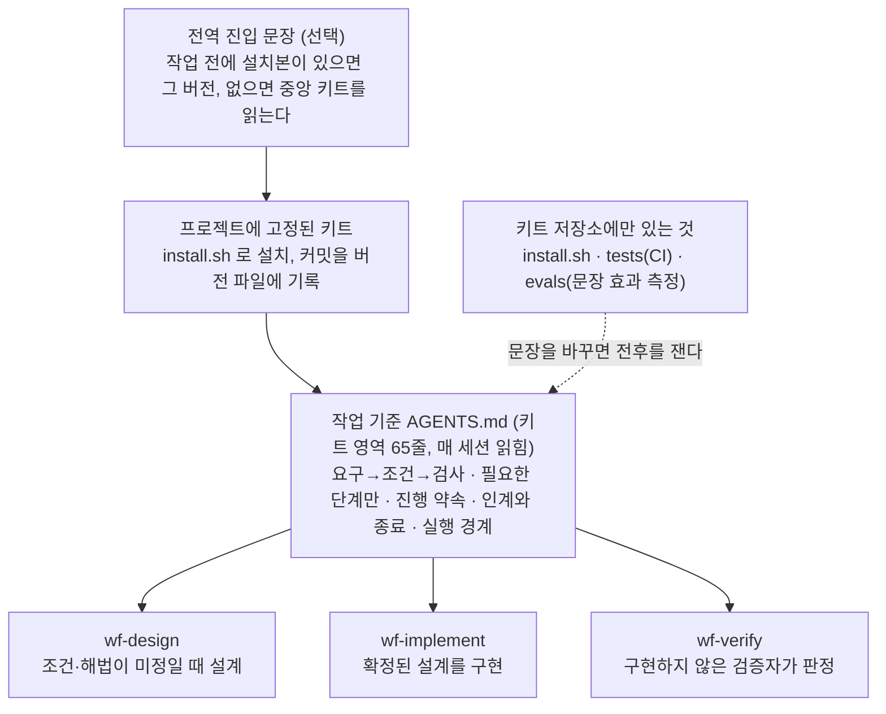
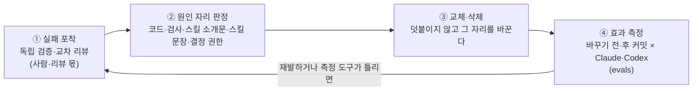

# agent-workflow-kit

**AI 코딩 에이전트가 "무엇을 확인해야 끝난 것인가"를 일하기 전에 정하고, 실제로 확인한 것만 완료라고 말하게 하는 작업 기준 키트.**

Claude Code·Codex 가 함께 읽는 작업 기준([AGENTS.md](AGENTS.md), 키트 영역 65줄) 한 장과 단계 스킬 3개, 그리고 그 기준이 실제 행동을 바꾸는지 재는 측정 도구([evals/](evals/))로 되어 있다.

> A thin work standard for AI coding agents (Claude Code, Codex): turn a request into observable conditions before building, close work only on observed results, and fix the cause instead of appending rules. Korean is canonical. No reuse license is currently specified.

## 이런 문제를 풀려고 만들었다

AI 에이전트에게 일을 맡기면 두 가지가 반복된다.

- **확인하지 않은 것을 "완료"라고 말한다.** 테스트를 돌리지 않았거나, 내부 함수만 봤거나, 요청과 다른 것을 확인하고 끝낸다.
- **실패할 때마다 규칙이 한 줄씩 붙는다.** "이건 하지 마라" 문서·체크리스트가 쌓이면 에이전트가 매번 읽는 지침이 무거워지고 규칙끼리 부딪힌다.

이 키트의 답은 네 가지다.

1. **완료 기준을 먼저 정한다**: 무엇을 어디서 관찰하면 끝난 것인지 일하기 전에 적는다.
2. **무엇을 만들지는 사용자가 승인한다**: 에이전트는 계획을 보여 주고 묻는다. 사용자가 "진행해 주세요"라고 답한 뒤에만 수정 도구로 코드를 쓸 수 있고, 이것은 훅이 기계로 막는다. 승인은 그 작업의 기준에 묶여, 철회하거나 기준이 바뀌면 다시 닫힌다.
3. **실패하면 덧붙이지 않고 원인 자리를 바꾼다**: 규칙을 더하는 대신, 실패를 만든 문장·코드·검사를 교체하거나 지운다.
4. **바꾼 것이 정말 효과가 있었는지 잰다**: 문장을 고쳤다는 사실이 아니라 새 세션의 행동이 달라졌는지로 판단한다.

이런 사람에게 맞다: 여러 저장소에서 AI 에이전트로 일하면서 "어디까지 확인했는지"를 믿을 수 있어야 하는 개발자·팀. 실무 스킬 묶음(TDD·리뷰 절차 등)이 아니라, 그 위에서 **언제 무엇을 확인해야 끝나는지**를 정하는 판단 층이다.

## 구조

여기서 **스킬**은 에이전트가 필요할 때만 꺼내 읽는 짧은 지침 파일(`SKILL.md`)이다. 작업 기준은 매 세션 읽히고, 스킬은 해당 단계에서만 읽힌다.



맨 위 **전역 진입 문장**은 선택이다. 사용자 전역 설정(예: `~/.claude/CLAUDE.md`, `~/.codex/AGENTS.md`)에 "프로젝트에 설치본이 있으면 그 버전을, 없으면 중앙 키트를 먼저 읽는다"는 문장을 두면, 키트가 설치되지 않은 저장소에서도 같은 기준이 적용된다. 키트 본문을 전역에 복사하지는 않는다. 복사하면 프로젝트에 고정한 버전과 최신 버전이 한 세션에 섞인다.

| 파일 | 하는 일 | 프로젝트에 설치? |
| --- | --- | --- |
| [AGENTS.md](AGENTS.md) | 작업 기준. 에이전트가 매 세션 읽는다. 아래에 프로젝트가 채우는 「프로젝트 지도」가 붙는다 | 설치(`<!-- agent-workflow-kit:begin -->`~`end` 사이만. 그 아래 지도는 프로젝트 몫) |
| [CLAUDE.md](CLAUDE.md) | Claude Code 가 AGENTS.md 를 읽게 하는 한 줄(`@AGENTS.md`) | 설치 |
| [.agents/skills/](.agents/skills/README.md) | 설계·구현·독립 판정 단계 스킬 3개(각 12~21줄, 필요할 때만 읽힌다)와 승인 관문 훅(`wf-design/approval-gate.py`) | 설치(훅은 `.claude/settings.json`·`.codex/hooks.json` 에 등록) |
| [install.sh](install.sh) | 설치·업데이트. 키트가 관리하는 부분만 바꾸고 프로젝트 내용은 보존 | — |
| [tests/](tests/README.md) | 설치기의 보장을 확인하는 시험(CI) | — |
| [evals/](evals/README.md) | 키트 문장을 바꿨을 때 새 세션의 행동이 달라졌는지 재는 실행기·사례 | — |
| [docs/](docs/README.md) | 스킬 소개문(description)을 바꿀 때 실제 선택을 확인하는 절차 | — |

폴더마다 README 가 있다. 이 문서를 다 읽지 않아도 각 폴더의 README 만으로 그 폴더가 무엇을 하는지 알 수 있다.

## 어떻게 동작하나

에이전트는 일을 받으면 구현부터 하지 않는다. 요구를 **관찰할 수 있는 조건**(예: "저장 버튼을 누르면 목록 맨 위에 새 항목이 보인다")으로 바꾸고, 그 조건을 확인할 검사를 먼저 정한다. 판정은 조건마다 충족·미충족·미확인 중 하나이고, 필수 조건에 미충족이나 미확인이 남으면 완료가 아니다.

그리고 **코드를 쓰기 전에 사용자의 승인을 받는다.** 에이전트는 먼저 읽어서 조사하고, 사용자가 받을 결과와 그 근거, 정해지지 않은 점, 확인 방법을 보여 준 뒤 묻는다. 사용자가 "진행해 주세요"·"승인합니다"처럼 답한 뒤에만 제품 파일을 쓸 수 있고, 승인은 그 작업의 기준(작업 지도 `## 기준` 또는 대화 안의 계획)에 묶인다. 상태를 묻는 다음 메시지에는 유지되고, 철회하거나 기준이 바뀌면 다시 묻는다. 이 규칙은 문장만으로 두지 않고 설치된 **승인 관문 훅**이 기계로 지킨다(아래 「실제로 써 보면」).

"확정"은 원문·사용자 결정·외부 계약으로 뒷받침되는 결과만 뜻한다. 사용자가 정정하거나 덧붙인 요청도 명시한 부분만 확정이고, 에이전트가 고른 안이나 이미 만든 구현은 승인 근거가 아니다. 그래서 정정 뒤에도 결과가 갈리는 선택이 남으면 추천과 함께 묻는다.

모든 일에 같은 절차를 강제하지도 않는다. 일을 시작할 때, 그리고 작업 중 연결·권한·검사가 바뀔 때마다 한 줄로 무게를 잰다.

> 확정 결과와 원문 근거 / 남은 결과 선택 / 연결 영향(결과에 기대는 사람·시스템) / 틀린 결과의 영향(사용자·데이터·권한과 회복 비용) → 필요한 단계

| 상황 | 단계 | 예 |
| --- | --- | --- |
| 조건·해법 확정, 연결 좁음, 영향 작음 | 단계 스킬 없이 직접 수정·확인 | 한 번 쓰고 지울 계산 스크립트 |
| 조건이나 해법이 미정 | wf-design | 저장 실패 뒤 입력을 어떻게 남길지 미정 |
| 확정된 설계를 인계받음 | wf-implement | 설계대로 저장 오류 수정 |
| 공용 경계 변경·큰 연결 불확실성·틀리면 영향 큼·사용자 요구 중 하나 | 별도 검증자가 wf-verify | 회계 시스템이 그대로 읽는 정산 스크립트 |

규칙 원문은 [AGENTS.md](AGENTS.md)의 「요구 → 조건 → 검사」와 「필요한 단계만」에 있다.

## 에이전트가 정하는 것, 사용자에게 묻는 것

한 줄로 줄이면 **어떻게 만들지(구현)는 에이전트가 정하고, 무엇을 만들지(결과)는 근거나 사용자가 정한다.** 판별은 질문 하나로 한다.

> 이 선택을 다르게 하면 사용자가 보는 결과, 외부와의 약속(계약), 작업 범위, 권한이 달라지는가?
> - 달라지지 않는다 → 에이전트가 정한다.
> - 달라지는데 원문·사용자 결정·외부 계약이 답을 준다 → 그 근거대로 정한다.
> - 달라지는데 근거가 없다 → 추천안과 함께 묻는다.

예는 할 일 목록 CLI 에 "완료한 할 일은 보관함으로 옮겨 주세요"를 받은 경우다.

| 에이전트가 정한다 | 사용자에게 묻는다 |
| --- | --- |
| 함수·변수 이름, 파일 나누기, 보관함을 별도 파일로 둘지 완료 표시로 구분할지(화면 결과가 같음) | 완료 즉시 옮길지 따로 정리 명령으로 옮길지, 보관함을 보는 명령을 둘지(화면 결과가 갈림) |
| 외부 계약이 정한 것: 정산 시스템이 내보내기 파일을 가져가므로 보관된 항목도 계속 포함 | 근거가 없는 외부 형식: 회계 시스템이 받을 금액 형식(정수인지, 소수 둘째 자리까지인지) |
| 기존 보장 지키기: 보관 후에도 할 일 번호가 겹치지 않게 | 요청에 없는 범위·권한·비용: 기능 추가, 삭제·배포처럼 되돌리기 어려운 일 |
| 사용자가 명시한 것 그대로 하기: "완료하면 바로, archive 명령으로"라고 다 말했으면 그 내용을 다시 정하지 않고 계획에 그대로 담아 승인만 받음 | 근거끼리 충돌: 초안 A 는 30일 보관, 초안 B 는 90일 보관 |
| 확인 방법(어떤 테스트·실행으로 볼지), 답과 무관한 부분부터 진행하는 순서 | 기준 낮추기: 검사 지우기, 실패 무시, 필수 조건 빼기 |

사용자에게 보이지만 사소한 것(안내 문구 표현 등)은 기존 화면의 방식을 따르고, 완료 보고에 "이렇게 정했다"고 밝힌다. 다만 **결과가 갈리는 선택을 "정하고 나중에 알리기"로 대신하지 않는다.** 그건 묻기를 건너뛴 것이다.

## 실제로 써 보면

사내 웹 키트 스타터(TypeScript 관리자 화면)에 설치하고, 평소 말투 그대로 요청해 본 결과다(Claude Code·Codex 모두 같은 흐름).

| 이렇게 말하면 | 첫 답 (코드는 아직 안 바뀜) | "진행해 주세요" 뒤 |
| --- | --- | --- |
| "아이디 비우고 로그인 누르면 아무 안내도 안 떠요. 버그인 듯해요." | 원인을 찾아 보여 준다("최근 커밋에서 안내 문구가 빈칸이 됐다"). 고칠 방법과 함께 "수정해도 될까요?" | 문구를 되돌리고, 같은 버그를 잡는 검사를 추가한 뒤 전체 검사 결과를 보고 |
| "…안내 문구가 안 떠요. 고쳐 주세요." | 위와 같다. 원인·고칠 내용·확인 방법을 보여 주고 묻는다 | 위와 같다 |
| "상품 카테고리 관리 화면을 구현해 주세요." | 조사해 보니 서버에는 카테고리 "조회"만 있다. "관리에 추가·수정·삭제까지 넣을지", "상품이 쓰는 카테고리는 지울 수 있게 할지"를 추천과 함께 묻는다 | (답한 결정대로 설계·구현) |
| "로그인 버튼 글자를 '로그인하기'로 바꿔 주세요." | 바꿀 한 줄, 같이 고칠 테스트, 그대로 둘 것(영어 버튼)을 보여 주고 묻는다 | 바꾸고 화면·브라우저 테스트까지 통과를 보고 |
| "검사가 통과하는지 확인만 해 주세요." | 승인 없이 바로 프로젝트의 검사(`pnpm test`·`typecheck`)를 돌려 결과를 보고한다. 조사는 막지 않는다 | — |

- **처음부터 맡기고 싶으면** "바로 고쳐 주세요"·"바로 구현해 주세요"라고 쓴다. 그 메시지가 승인이 되어 한 번에 끝난다.
- **비용**은 할 일이 분명한 요청에서 "진행해 주세요" 한 번이다. 대신 에이전트가 정해지지 않은 정책(예: 탈퇴한 회원의 재가입 허용 여부)을 마음대로 정해 구현하는 일이 막힌다. 측정에서 이 실패는 Codex 0/6 → 12/12 로 바뀌었다([이슈 #20](https://github.com/taehyung-lab/agent-workflow-kit/issues/20)).
- **훅이 하는 일**: 승인 전에는 파일 수정 도구를 막는다. 셸은 어느 언어의 검사든 미리 막지 않고, 턴이 끝날 때 제품 파일이 바뀌었으면 바뀐 파일을 알려 에이전트가 자기 변경만 되돌리거나 사용자에게 알리게 한다(사후 감지, 관문이 직접 되돌리지 않음). 묻지 않고 넘어가는 **실수를 막는 장치**이고, 에이전트가 일부러 훅을 고치는 것까지 막지는 않는다. 자세한 동작은 [.agents/skills/README.md](.agents/skills/README.md).

## 검증은 합의한 것만 본다

검증의 대상은 **일하기 전에 합의한 조건**이다. 검증자는 조건별 실제 결과와 원문 근거로 판정하고, 조건 밖에서 빠진 것을 발견하면 판정하지 않고 설계로 돌려보낸다. 구현하는 쪽은 요청 범위 밖의 동작·표현을 그대로 보존한다(AGENTS.md 「진행 약속」).

- 검증자는 구현하지 않은 사람이다(개인 작업에서는 같은 모델의 별도 새 세션도 된다). 구현자의 자기평가는 검증자가 자기 판정을 쓴 뒤에 대조한다.
- 판정 중에는 기준·코드를 고치지 않고, 판정하는 동안 대상이 바뀌면 그 판정은 무효다.
- 필수 조건을 빼거나 낮추는 것은 사용자만 정한다. 검사를 지우거나 실패를 무시하는 것은 "기준 변경"으로 별도 검토를 받는다.

### 내가 정리·구현·검증까지 하면 믿을 수 있나

검증의 설득력은 "누가 검증하느냐"보다 **"무엇으로 판정하느냐"**에서 나온다. 매번 별도 세션에 맡기는 대신, 키트는 자기 검증이 성립하는 조건을 정해 두고 그걸로 부족할 때만 검증자를 바꾼다.

1. **조건과 그 근거를 구현 전에 적는다.** 구현 뒤에 기준을 정하면 무엇이든 통과한다. 조건에 원문·사용자 결정·외부 계약이 붙어 있으면, 판정자는 구현자의 해석이 아니라 그 근거와 대조한다.
2. **관찰로 판정한다.** 화면·URL·요청·출력처럼 다른 사람이 같은 결과를 볼 수 있는 것으로 닫고, 내부 호출만 보는 검사로는 닫지 않는다.
3. **검사가 위반을 잡는지 먼저 확인한다.** 새 검사마다 "조건을 어긴 경우"를 정해 검사가 실패로 판정하는지 본다([wf-design](.agents/skills/wf-design/SKILL.md) 4). 통과만 하는 검사는 증거가 아니다.
4. **증거를 남긴다.** 조건별 입력·실제 결과·버전을 남겨, 나중에 누구든 다시 볼 수 있게 한다([wf-implement](.agents/skills/wf-implement/SKILL.md) 4).

이 네 가지가 갖춰진 작고 영향이 좁은 일은 자기 검증으로 닫는다. **공용 경계를 바꾸거나, 연결이 불확실하거나, 틀리면 영향이 크거나, 사용자가 원하면** 구현하지 않은 검증자가 판정한다. 이때 검증자에게는 원문·확정 조건·변경물만 넘기고, 구현자의 "통과했다"는 주장은 검증자가 자기 판정을 쓴 뒤에 대조한다. 구현자가 스스로 정한 조건을 그대로 넘기면 검증자도 그 조건으로 통과시키므로, 넘길 때는 조건마다 근거가 붙어 있어야 한다.

### 외부가 아직 없을 때 (예: 서버 API 가 아직 없다)

검증 기준을 "완벽하게" 만드는 게 아니라 **지금 확인할 수 있는 조건과 그렇지 않은 조건을 나눈다.**

- **지금 확인한다:** 합의한 API 명세(요청·응답 모양, 오류 코드)를 근거로, 대역(가짜 서버 응답)을 써서 화면이 성공·실패·빈 결과를 명세대로 보여 주는지 판정한다. 명세에 없는 응답 모양은 지어내지 않고 질문으로 남긴다.
- **미확인으로 남긴다:** 실제 서버가 있어야 알 수 있는 것(실제 응답 시간, 인증 만료, 서버가 명세와 다르게 주는 값)은 대역으로 "충족"이라 하지 않는다. 사유와 재개 조건("서버 연결 후 이 3개 조건을 실서버로 다시 판정")을 남기고, 확인된 부분의 완료와 구분해 보고한다([AGENTS.md](AGENTS.md) 「요구 → 조건 → 검사」 3항).
- 미확인 조건을 빼거나 권고로 낮추는 것은 사용자가 정한다.

자세한 절차는 [wf-verify](.agents/skills/wf-verify/SKILL.md)에 있다.

## 실패에서 배우는 루프



학습의 성과는 기록이 늘어나는 것이 아니라 **다음 작업이 읽는 문장·코드·검사가 바뀌는 것**이다. 실패 원인이 구현이면 코드를, 틀린 결과가 통과했으면 검사를, 필요한 스킬을 못 찾았으면 그 스킬의 소개문을, 반복될 판단이 틀렸으면 그 스킬의 문장을 고친다. 결정을 쥔 쪽이 잘못 놓였으면(구현자가 스스로 승인하는 등) 그 권한을 집행하는 실행 경계(훅·하네스 권한)를 고친다. "주의사항 문서"를 따로 만드는 자리는 없다.

### 실제 사례: "묻지 않고 정한다"를 고친 과정

사용자가 "탈퇴는 지우지 말고 비활성화하라는 뜻이었어요"라고 정정하면, Codex 는 "비활성 계정은 로그인 불가, 재가입 차단" 같은 정책을 묻지 않고 정해 구현했다(0/6). 고친 순서는 이랬다.

1. 판단 문장을 바꿨다 → 효과 없음, 되돌림.
2. 실행기가 별도 검증 세션을 띄웠다 → 검증자는 잡았지만 구현자가 코드를 남김.
3. 검증 도구를 키트에 넣었다 → Codex 가 거의 실행하지 않음, 되돌림.
4. 턴 끝에 LLM 검증 훅을 붙였다 → 판정이 흔들리고 명시된 요청까지 막음, 되돌림.
5. "결정 표"를 쓰게 하고 기계로 검사했다 → Codex 가 그럴듯한 출처를 적어 통과, 되돌림.
6. **원인 자리를 다시 봤다**: 다섯 번 모두 "구현자가 해석·승인·쓰기를 다 쥔" 구조 안에서 고쳤다. 승인을 사용자 쪽으로 옮기는 승인 관문을 넣었다 → 12/12, 채택.

교훈은 4항에 반영했다: 문장·검사를 여러 번 고쳐도 안 되면, 결정 권한이 어디 놓였는지 본다.

④ 측정은 [evals/](evals/)가 맡는다. 지정한 키트 커밋을 격리한 새 프로젝트에 설치하고, 예상 답을 주지 않은 Claude·Codex 새 세션에 사례를 실행해 원시 기록·판정·AGENTS.md 바이트를 남긴다. 사례마다 통과·실패 표본이 있어서 CI 가 "판정 검사가 위반을 정말 잡는가"를 매번 확인한다. 이 저장소는 효과가 보이지 않으면 문장을 더 강하게 고치지 않고, [이슈](https://github.com/taehyung-lab/agent-workflow-kit/issues)로 미확인을 추적한다.

세션을 관찰해 규칙 후보를 자동으로 만드는 일은 일부러 하지 않았다. 그러면 실패마다 파일이 늘어나는 "덧붙임"을 자동화하는 셈이기 때문이다. 기계적으로 판별되는 실수를 잡는 검사는 자동화한다.

## 5분 시작

```bash
git clone --branch v2.0.2 https://github.com/taehyung-lab/agent-workflow-kit
bash agent-workflow-kit/install.sh /path/to/my-project
```

1. 설치기가 `AGENTS.md`(키트 영역 + 빈 프로젝트 지도), `CLAUDE.md`, `.agents/skills/wf-*`, `.claude/skills` 링크를 만들고, `.gitignore` 에 `/work/`(작업 지도 자리)를 더하고, `.agents/agent-workflow-kit.version` 에 커밋을 기록한다. 승인 관문 훅(사용자가 승인한 뒤에만 수정 도구로 제품 파일을 쓰게 하는 훅)을 `.claude/settings.json`·`.codex/hooks.json` 에 더한다(기존 항목은 그대로 둔다). Codex 는 처음 실행할 때 훅을 신뢰할지 묻는다. 신뢰해야 훅이 돈다. 이미 `AGENTS.md`·`CLAUDE.md`·`work/` 가 있으면 쓰기 전에 멈춘다. 그때는 아래 「진행 중인 프로젝트에 연결하기」를 본다.
2. `AGENTS.md` 아래 「프로젝트 지도」에 제품 원문 위치, 코드 진입점, 실행·검사 명령, 권한·보호 대상을 적는다. 모르는 칸은 `미확인`으로 둔다.
3. 새 세션에서 작은 요청 하나를 주고, 계획을 보여 주며 승인을 묻는지 본다. Codex 는 처음 실행할 때 나오는 "훅 신뢰" 화면에서 신뢰를 고르거나, 나중에 Codex 안에서 `/hooks` 를 열어 신뢰한다. worktree 를 자주 만들면 사용자 전역에 한 번 등록하는 편이 낫다([.agents/skills/README.md](.agents/skills/README.md)). 팀에 도입한다면 아래 「도입 확인」을 거친다.

### 키트 문장을 고쳐 기여할 때

기본 브랜치를 clone 하고 저장소 안(`cd agent-workflow-kit`)에서 실행한다. 바꾼 문장은 **커밋한 뒤** 잰다. 실행기는 지정한 커밋을 새로 clone 해서 쓰므로 커밋하지 않은 수정은 측정에 들어가지 않는다. 같은 하네스(Claude Code·Codex 처럼 모델을 감싸 실행하는 도구)끼리 바꾸기 전·후를 비교해야 차이가 문장 때문인지 알 수 있다.

```bash
bash evals/run.sh weight-accounting v1.1.0 claude   # 바꾸기 전 커밋
bash evals/run.sh weight-accounting HEAD claude     # 바꾼 뒤(커밋한 상태). Codex 도 같은 두 줄을 codex 로
python3 -I evals/report.py evals/results           # 사례·하네스·커밋별 통과·검토 필요 수·시간·AGENTS.md 바이트
python3 -I evals/rejudge.py evals/results/<폴더>    # 판정 검사를 고친 뒤, 저장된 결과를 다시 판정
bash evals/selftest.sh                             # 모델 없이: 판정 검사가 표본을 구별하는지
```

판정은 세 가지다: **통과**, **실패**, **검토 필요**(검사가 자동으로 가를 수 없어 원시 기록을 사람이 본다). 사례 폴더에 `prompt2.txt`·`prompt3.txt` 를 두면 같은 세션을 이어 가는 여러 턴 사례가 된다(예: 구현 뒤 사용자가 정정하는 상황).

`run.sh` 는 `claude` 또는 `codex` CLI 가 설치·로그인되어 있어야 하고, 실제 모델 세션을 임시 프로젝트 폴더에서 실행한다(Claude 는 권한 확인 없이, Codex 는 그 폴더 쓰기 허용으로, 한 번에 최대 15분).

## 다른 키트와 함께 쓰기

이 키트는 판단 층이라 실무 스킬 묶음과 경쟁하지 않는다. 예를 들어 [addyosmani/agent-skills](https://github.com/addyosmani/agent-skills)의 TDD·리뷰 스킬이나, 스택별 공용 코드 키트(예: 사내 웹 UI 키트 web-kit)의 역할 스킬을 함께 쓸 수 있다. 다만 외부 스킬이 별도 계획·필수 질문·검증을 중복으로 강제하면 함께 켜지 않는다(아래 「역할 스킬과 외부 묶음」). 세션을 자동 관찰해 규칙을 생성하는 방식([affaan-m/ECC](https://github.com/affaan-m/ecc)의 continuous learning)은 위의 이유로 들이지 않았다.

---

## 운영 안내

설치·업데이트·복구·도입 확인의 세부 보장이다. 처음 쓴다면 위 「5분 시작」으로 시작할 수 있고, 문제가 생기거나 기존 프로젝트에 붙일 때 아래를 본다.

### 지원 범위

- 대상: 한국어로 작업 지시·기록을 주고받는 Git 저장소. 키트 문서의 기준 언어는 한국어다.
- 자동 시험(`tests/install.test.sh`)이 확인하는 것은 설치·업데이트의 파일 배치와 거절 동작, 승인 관문 훅 등록(기존 설정 보존, 사건마다 하나, 관문이 빠진 버전에서 키트 항목만 제거)이다.
- 승인 관문 훅은 묻지 않고 넘어가는 실수를 막는 장치다. 에이전트가 의도적으로 승인 기록이나 훅을 고치는 것은 막지 않는다. 그것까지 막으려면 하네스의 읽기 전용 실행을 함께 쓴다. Python 3 가 없으면 등록하지 않고 그 사실을 출력한다.
- Claude Code는 CLAUDE.md(`@AGENTS.md`)와 `.claude/skills` 링크로, Codex는 AGENTS.md와 `.agents/skills`로 읽도록 배치한다. 각 런타임이 스킬을 실제로 찾고 고르는지는 이 저장소가 보증하지 않으므로 도입 확인에서 새 세션으로 직접 확인한다.

### 설치

확인한 버전의 로컬 키트 git checkout(미커밋 변경 없음)에서 `bash /path/to/agent-workflow-kit/install.sh /path/to/target-repository`를 실행한다.
기존 설치 대상·루트 work 경로·부모 심링크·부모 비디렉터리는 쓰기 전에 거절한다. .gitignore는 일반 파일만 허용하고 기존 내용에 `/work/` 줄이 없으면 덧붙인다.
다른 설치·편집이 없는 대상에서 실행한다. 권한·I/O 실패 때 일부 신규 파일이 남을 수 있으므로 종료 코드와 대상을 확인하고 병합 범위를 정한다.
CLAUDE.md는 `@AGENTS.md`, `.claude/skills`는 `.agents/skills`를 가리킨다. 승인 관문 훅은 `.claude/settings.json`·`.codex/hooks.json`의 `hooks`에 명령에 `approval-gate.py`가 든 항목으로 더하고, 업데이트 때 그 항목만 교체한다. 설정 파일이 올바른 JSON 이 아니면 쓰기 전에 멈춘다.
키트가 관리하는 부분은 AGENTS.md의 `agent-workflow-kit:begin`~`end` 표시 영역, CLAUDE.md, 키트가 설치한 `.agents/skills/wf-*` 파일이다. 프로젝트는 이 부분을 고치지 않고, 지도·저장소별 절·역할 스킬은 표시 영역 밖에 둔다. 설치한 키트 커밋은 `.agents/agent-workflow-kit.version`에 남고, 프로젝트는 이 고정 버전을 따른다. 이 키트는 세션을 자동 생성하지 않는다.
도입은 다섯 걸음이다: 설치 → 저장소 관찰 → 지도 네 칸 채우기(근거가 없으면 `미확인`) → 기존 에이전트 문서마다 유지·이동·폐기 결정 → 다음 작은 실제 요청 하나로 지도와 스킬 선택이 맞는지 확인.
에이전트에게 맡길 때: "https://github.com/taehyung-lab/agent-workflow-kit 를 clone해 install.sh로 이 저장소에 설치하고, 저장소를 조사해 AGENTS.md 지도 네 칸을 채워줘. 근거가 없는 칸은 미확인으로 두고, 기존 에이전트 문서는 유지·이동·폐기안을 보여줘. 설치기가 멈추면 병합안을 먼저 보여줘."

### 새 프로젝트의 지도

AGENTS.md의 네 항목에는 저장소가 관리하는 근거의 위치와 한 줄 설명만 적는다. 상세 값과 규칙은 그것을 관리하며 기준으로 삼는 기록에 둔다.
제품 원문·사용자 결정은 실제 원문과 결정권자를, 코드·계약은 진입점·각 부분이 맡는 책임·명세를, 실행·검사는 명령 정의·환경을, 권한은 실제 설정·질문 대상을 가리킨다.
아직 없는 근거는 `미확인`으로 남기고 첫 작업에 필요한 공백만 묻는다. 빈 칸을 채우려고 문서나 역할 스킬을 미리 만들지 않는다.
사용자가 정한 저장소별 진행 약속만 지도 아래 별도 프로젝트 절에 둔다. 키트 기본값과 다르게 적용할 때도 키트 영역을 고치지 않고 프로젝트 절에 "이 저장소에서는 …"으로 적용 범위와 함께 적는다. 개인 셸 설정·설치 경과·스킬 목록은 지도에 옮기지 않는다.
키트는 주석을 프로젝트의 주석 관례에 맡기고, 요청 범위 밖의 동작과 표현을 보존한다. 그보다 구체적인 개인 선호(한글 주석, UI 보존)를 계속 쓰려면 프로젝트 절에 이렇게 적는다.

```markdown
## 이 저장소의 진행 약속

- 이 저장소에서는 새로 만들거나 역할이 바뀐 코드 파일 맨 위에 파일의 책임을, 각 함수·컴포넌트에는 맡은 일을 한글 주석으로 짧게 적는다.
- 이 저장소에서는 요청이 명시하지 않은 UI·레이아웃을 바꾸지 않는다.
- 이 저장소에서는 인계 기록을 `.work/<작업명>/work.md`에 둔다.
```

마지막 줄처럼 인계 기록 경로를 바꾸면 그 경로(예: `/.work/`)를 .gitignore에 더한다. AGENTS.md 키트 영역과 wf-design은 프로젝트 절의 경로를 따르도록 쓰여 있으므로 고치지 않는다.

### 진행 중인 프로젝트에 연결하기

설치기가 충돌로 멈추면 기존 문서를 지우고 재실행하지 말고, 아래 책임으로 비교한 병합안을 먼저 보여준다.
병합 결과의 AGENTS.md는 키트 원본의 표시 영역을 그대로 담고 프로젝트 내용은 그 밖에 둔다. CLAUDE.md와 키트의 `.agents/skills` 파일도 같은 커밋의 원본과 같게 맞추고, `.agents/agent-workflow-kit.version`에 그 커밋을 적는다. 표시 영역이 없던 이전 설치본도 같은 방법으로 한 번 정리한다. 그 뒤부터는 아래 업데이트를 쓴다.
저장소 고유 사실·결정·열린 질문은 이를 관리하며 기준으로 삼던 기존 기록에 보존하고 지도에서 연결한다. 중복 작업 절차는 키트로 교체하며, 근거 있는 역할 기준은 역할 스킬에, 사용자가 정한 저장소별 약속은 프로젝트 절에 남긴다(공통 진행 약속은 키트가 맡는다).
원문 사본은 원문 위치·원문에 없는 결정·열린 질문 중심으로 줄인다. 다른 도메인의 선례를 기준으로 승격하지 않으며, 근거끼리 충돌하면 사용자에게 결정을 받는다.
이동·삭제한 대상을 참조하거나 사용하던 링크·검사·스크립트도 함께 정리한다. 의미 보존은 원문과 diff로 검토하고, 판단을 대신하던 형식 검사는 대체 보고기 없이 걷어낸다.
기존 스킬·실제 `.claude/skills` 폴더·work 경로가 있으면 내용과 사용처를 보존하는 병합안을 정한다. 기존 `work` 경로가 다른 용도라 인계 기록을 다른 곳에 두려면, 키트 파일은 원본 그대로 두고 위 「새 프로젝트의 지도」의 예처럼 프로젝트 절에 경로를 적고 ignore 범위를 맞춘다.

### 업데이트

실행 전에 아래 「부분 실패 복구와 제거」의 업데이트 전 준비를 한다. 새 키트 커밋을 확인한 로컬 키트에서 `bash /path/to/agent-workflow-kit/install.sh --update /path/to/target-repository`를 실행한다.
설치기는 설치된 버전의 원본과 비교해 키트가 관리하는 부분이 그대로일 때만 그 부분을 새 커밋으로 교체하고 버전 파일을 갱신한다. 프로젝트가 관리하는 부분은 건드리지 않는다.
키트가 관리하는 부분에 로컬 변경이 있으면 이미 같은 버전이어도 아무것도 쓰지 않고 그 경로를 알린다. 그 변경은 프로젝트 절·역할 스킬로 옮기거나 키트에 반영한 뒤 다시 실행한다. 키트가 쓰는 경로의 부모가 심링크이거나 폴더가 아니면 설치와 같이 쓰기 전에 거절한다.
교체 결과를 diff로 검토하고, 아래 도입 확인 중 바뀐 것에 맞는 확인을 거친 뒤 반영한다. 확인을 마치지 못하면 남은 확인을 함께 남긴다.

### 부분 실패 복구와 제거

설치기가 중간에 실패하면(종료 코드가 0이 아니고 `Install failed; partial files may remain.`가 뜨면) 대상의 실제 파일을 확인한다. `git status`는 ignore된 경로를 숨기므로 `git status --ignored`와 `ls -la`로 키트 경로를 직접 본다.
아래에서 `<kit>`는 로컬 키트 checkout이고, 목록(X)은 키트 커밋 X가 통째로 소유하는 파일, 곧 `CLAUDE.md`와 `git -C <kit> ls-tree -r --name-only X -- .agents/skills`의 출력이다.

- **업데이트 전 준비:** 대상의 미커밋 변경(프로젝트 절·역할 스킬·인계 기록 포함)을 커밋하거나 백업하고, `.agents/agent-workflow-kit.version`의 커밋(이하 O)을 따로 적어 둔다. 버전 파일은 마지막에 쓰지만 쓰는 도중 실패하면 비거나 잘릴 수 있으므로, 실패 뒤의 버전 파일은 O의 근거가 아니다.
- **처음 설치 실패:** 처음 설치는 AGENTS.md·CLAUDE.md·`.claude/skills`·버전 파일·목록(설치 커밋)의 스킬 폴더가 하나도 없을 때만 쓰므로, 지금 있는 그 경로는 설치기가 만든 것이다. 실제로 있는 그 경로만 지우고, 원래 있던 `.agents/skills`·`.claude` 안의 다른 파일은 둔다. .gitignore는 설치 전 내용과 비교해 덧붙은 `/work/` 줄만 지운다. 원인을 고친 뒤 다시 실행한다.
- **업데이트 실패:** 키트 소유 부분만 O의 원본으로 맞춘다. 대상의 HEAD·index는 O와 다를 수 있고 `.agents/skills`에는 역할 스킬이 함께 있으므로, 이들을 통째로 되돌리지 않는다.
  1. AGENTS.md는 표시 영역(시작·끝 줄 포함)만 `git -C <kit> show O:AGENTS.md`의 같은 영역으로 바꾸고 영역 밖은 그대로 둔다.
  2. 목록(O)의 각 경로에서 사라진 부모 폴더를 먼저 만들고, `git -C <kit> show O:<경로> > <경로>`로 쓴다.
  3. 목록(O)과 목록(새 커밋)을 비교해 새 커밋에만 있는 경로를 지운다. 업데이트는 그런 경로가 이미 있으면 쓰기 전에 멈추므로, 남은 것은 이번 실패가 만든 것이다. 두 목록에 없는 역할 스킬과 인계 기록은 건드리지 않는다.
  4. 버전 파일에 O를 쓰고 다시 실행한다. 종료 코드가 0이고 갱신 성공 또는 `Already at`가 나오는지 확인한다. 실패하면 오류가 가리킨 원인을 확인한다.

  O를 적어 두지 않았거나 키트에 없는 커밋이면 백업·대상 Git 이력에서 O를 확인한다. 확인되지 않으면 추측해 쓰지 않고 멈춰 사용자와 정한다.

제거하는 설치기는 없다. 버전 파일의 커밋 V를 백업·이력으로 확인하고, ignore된 경로까지 실제 파일을 본 뒤 V의 원본과 같은 키트 부분만 지운다: AGENTS.md의 표시 영역(영역 밖에 프로젝트 내용이 없으면 파일 전체), 목록(V)의 파일, `../.agents/skills`를 가리키는 `.claude/skills` 링크, 버전 파일, 그리고 비게 된 `.agents/skills`·`.claude` 폴더다. 원본과 다른 파일, 목록에 없는 역할 스킬, 프로젝트 절, 인계 기록의 미완료 자료는 남기고 처리를 사용자와 정한다. .gitignore의 `/work/` 줄은 키트가 덧붙였음이 이력으로 확인되고 인계 기록을 더 쓰지 않을 때만 지운다. V나 소유가 확인되지 않으면 추측해 지우지 않는다.

### 도입 확인

확인의 무게는 설치된 버전부터 새 커밋까지 바뀐 것 중 가장 무거운 단계에 맞춘다.

- **설치기·설치 경로만 바뀐 업데이트**(AGENTS.md 키트 영역·CLAUDE.md·`.agents/skills/wf-*` 파일 내용은 그대로): `tests/install.test.sh`가 통과한 커밋인지와, 대상의 diff가 버전 파일 갱신(설치 경로가 바뀌었다면 그 이동)뿐인지 확인한다. 새 세션에서 세 wf-\* 스킬이 발견되는지 본다.
- **처음 도입하거나 작업 판단 문장(AGENTS.md 키트 영역·CLAUDE.md·wf-\*)이 바뀐 업데이트**: 위에 더해, 이번 도입에서 사용할 실행 환경·모델 조합마다 대표 요청 하나를 격리한 worktree에서 실행해 구현하지 않은 검토자가 판정한다. ① 원문·역할 스킬·공용 코드의 근거를 조건과 [기존] 조건으로 옮겼는가 ② 변경이 실제 결과에 반영되는 경로에서 조건을 지키며 기존 공용을 쓰고 불필요한 책임·계층 없이 이해할 수 있는가(기존 검사와 위반 반례 포함) ③ 실패가 생긴 원인과 그것을 놓친 검사·판단의 원인을 구별했는가. 진행 중인 프로젝트에 연결한 병합도 이 확인 뒤 반영한다.
- **특정 실패의 교정으로 판단 문장을 일반화해 바꾼 업데이트**(커밋·교정 기록에 막으려는 실패가 적힌 경우): 위에 더해 ④ `evals/`의 그 실패 사례와 다른 도메인 유사 사례로 변경 전후 커밋을 `evals/run.sh` 실행해 재발 여부, 작은 요청(`weight-disposable`) 부담, AGENTS.md 바이트를 본다.

설치 확인·한 번의 통과를 전체 성능 개선의 증거로 보고하지 않는다.

### 역할 스킬과 외부 묶음

반복되는 판단을 맡을 곳이 필요할 때 `.agents/skills/<이름>/SKILL.md`를 만든다. description에는 읽을 책임과 인접 책임의 경계를 적는다.
본문은 출처 있는 확정 기준·관찰 조건과 미정을 구분한다. description이나 스킬의 담당 범위를 바꿀 때는 [스킬 선택 확인](docs/skill-selection.md)으로 필요한 요청·동의어·무관한 요청에서 실제 선택을 확인한다.
이 키트는 지도에서 필요한 근거를 찾고 요구→조건→설계·구현→검증→원인 교정으로 잇는 작업 흐름과 인계를 맡는다. 확정된 작은 변경은 설계·인계 문서 없이 직접 수정·확인한다. 역할 스킬의 description으로 바뀌는 책임을 찾고 해당 본문만 읽으며, 외부 스킬은 그 작업에서 부족한 능력만 맡긴다.
같은 스택·계약의 공통 코드와 사용 기준은 그 스택의 공용 키트(예: web-kit)가 같은 버전으로 배포한다. 소비 프로젝트는 고정 버전의 코드·스킬을 사용하고 제품 정책·연결 차이만 관리한다. 공통 동작을 바꿀 때는 그 키트와 실제 소비자의 검사까지 연결한다. 이 작업 흐름 키트에 라이브러리별 구현·사용법을 옮기지 않는다.

프로젝트가 더하는 내용은 다음 소유자에 둔다. `wf-*`는 이 키트의 예약 이름이며, 외부 키트가 배포하는 스킬 이름도 프로젝트 스킬로 덮어쓰지 않는다. 프로젝트 스킬은 구별되는 이름(예: `<프로젝트접두>-<책임>`)으로 만든다.

| 더하는 내용 | 소유 위치 |
|---|---|
| 제품 값·사용자 결정·서버별 계약 | 프로젝트가 이미 기준으로 삼는 기록. AGENTS.md 지도는 그 위치를 가리킨다 |
| 반복되는 제품 고유 판단 | 필요할 때만 프로젝트 역할 스킬. 공통 조립법은 공용 키트 스킬, 제품 근거·검사 위치는 프로젝트 지도에서 찾는다 |
| 프로젝트별 진행 약속 | AGENTS.md의 키트 표시 영역 밖 프로젝트 절 |
| 여러 프로젝트가 공유할 동작·기본 UI와 그 사용 기준 | 해당 라이브러리 키트. 같은 책임·수명·실패를 공유하는지 확인해 편입한다 |

예를 들어 저장 중 중복 실행을 막는 것은 라이브러리 키트의 보장이고, 저장 후 완료창을 띄운 뒤 이동하는 것은 프로젝트의 절차다. 프로젝트 역할 스킬은 그 절차와 연결 차이만 적고 중복 실행 방지 규칙을 다시 쓰지 않는다. 공용 편입은 프로젝트 수나 코드 모양보다 같은 보장을 유지하는지로 판단한다.

채택 전에 본문·출처·라이선스·고정 버전·권한·도구 의존성을 확인한다. 스킬 이름이나 묶음 전체를 기본 설치 목록으로 삼지 않는다.
사용자 지시가 우선이며, 이 키트를 선택한 프로젝트에서는 키트의 단계·완료 경계를 유지한다. 외부 스킬이 별도 계획·필수 질문·검증·기록을 중복 강제하면 그 스킬은 함께 활성화하지 않는다.
그 능력이 꼭 필요하면 출처와 변경 이유를 남긴 조정본을 선택한다. 다른 전체 운영 흐름으로 바꾸려면 사용자와 교체 범위를 정하며, 두 흐름을 중첩하지 않는다.

### 라이선스

현재 별도 재사용 라이선스가 없다. 복제·수정·재배포 조건은 저장소 소유자에게 확인한다.
