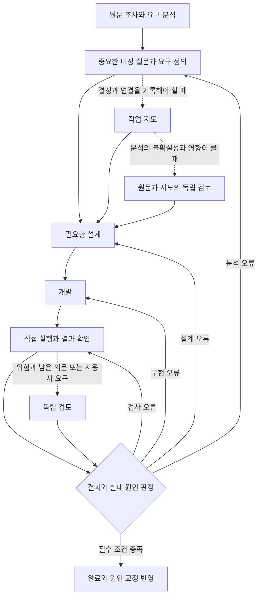

# 키트의 지향점과 설계 판단 기준

이 키트는 요구사항을 정확히 정의하고, 그 정의를 필요한 설계·개발·검증으로 연결하며, 실패의 원인을 고쳐 다음 작업의 판단까지 개선하는 흐름을 지향한다. 2026-11-10 사용자 확정: grilling·tdd·review 같은 외부 스킬을 설치·호출하지 않아도 그 스킬들이 맡던 책임(요구 분석, 중요한 선택만 먼저 질문, 요구에서 기대값을 정해 작게 구현·시험, 원문 대비 결과 검토)을 키트의 짧은 기준으로 작업에 맞는 깊이만큼 수행하고, 스킬을 설치한 구성과 같거나 나은 결과를 내는 것이 목표다. 기본 흐름은 목표와 요구 이해 → 필요한 질문 → 설계·개발·시험 → 결과 검토 → 완료 또는 원인 교정이다. 사용자가 결정해야 하는 애매함은 질문으로 풀고, 분석·설계·구현 중 어디에서 잘못됐는지 구분해 그 자리로 돌아간다.

문서는 얇게 유지하되 요구의 정의와 검증 근거는 충분해야 한다. 사용자의 개입과 비용을 줄이는 것은 이 흐름이 잘 작동한 결과다. 질문이나 문서가 짧아졌다는 사실만으로 개선을 판단하지 않는다.

## 운영 방향과 사용자 결정 기록

매 세션 읽는 기준(AGENTS.md 키트 영역)은 기본 규칙과 「단계」 표만 둔다. 제품 파일을 바꾸는 작업은 요구 확인(`wf-ask`) → 구현(`wf-build`) → 결과 검토(`wf-verify`) 단계를 순서대로 호출하고, 절차는 그 단계 파일 한 곳에만 둔다. 요청이 바꿀 곳과 결과를 글자 그대로 정한 변경은 단계 없이 바로 한다. 작업 지도와 독립 검토는 그 작업의 결정과 연결을 유지하거나 구체적인 오류를 막는 데 필요할 때 쓴다(필수 검토는 예외 없이 받는다). 아래는 이 구조에 이르기까지의 사용자 결정을 날짜대로 둔 기록이다. 측정 표와 실행별 수치는 [measurements.md](measurements.md)에 있다.

2026-11-05 사용자 결정(v3.1): 자연어 승인 판별 관문(approval-gate.py)과 그 훅을 없앤다. 요청 이해와 범위 판단은 AI 와 지침이, 파일 쓰기·명령의 실제 허용은 각 도구의 권한 설정·sandbox 가, 결과 확인은 검사·diff 검토가 맡는다. 훅은 도구 설정으로 지킬 수 없는 구체적 요구가 있을 때만 둔다. 분명한 실행 요청은 그 자체가 승인이다. [measurements.md](measurements.md) 「세 구성 비교」 표의 관문 관련 항목은 그 전의 판단 기록이다.

2026-11-05 사용자 결정(v3.2, 맥락 유지): ① 세션 시작·재개 때 위치 정보(실경로·커밋·변경 여부·설치 키트 버전·작업 지도)를 자동으로 넣는다. 정보만 넣고 차단·승인 판독은 하지 않으며, 훅을 지원하지 않거나 실행하지 않는 도구는 `context.py inspect` 명령으로 대신한다. 위 "구체적 요구"가 이것이다: 도구 권한 설정으로는 "지금 어느 저장소·버전인가"를 세션에 알려 줄 수 없다. ② 발행 평가: 맥락 이탈·정상 대조·재개/인계 핵심 사례를 Claude·Codex 두 모델로 돌려 통과해야 발행한다. 실행하지 못한 것은 통과로 세지 않는다. 판단 기준은 AGENTS.md 기본 1 과 작업 지도의 `## 맥락`(당시 guide.md 「맥락 봉투」, 지금은 [wf-ask/map.md](../.agents/skills/wf-ask/map.md))이, 측정은 `evals/cases/ctx-*` 가 맡는다.

2026-11-06 사용자 결정(v3.3, 완료 기준): 검증 기준은 미리 정확히 정하고, 애매한 것은 완료가 아니라 물어서 정한다. 구현은 요구 기록 표(확정·미정·미확인)와 한 규칙의 완료 판정(verify.completion)이 맡는다. 테스트 결과를 보고 문장을 덧붙이지 않고, 원인이 있는 자리(지침·도구·시험 기준·실행 지시)를 교체한다(아래 「개선을 채택하고 작업을 끝내는 기준」). goalflow 의 사용자 답(answer.txt) 세 가지는 시험용 가상 앱의 정책으로 사용자가 정했다.

2026-11-10 사용자 결정(v3.5, Codex 정보 훅 제거): v3.2 의 세션 시작 정보 훅을 Codex 에서는 두지 않는다. Codex 는 프로젝트 훅을 경로·명령마다 따로 신뢰받아야 실행하고 신뢰 전에는 경고 없이 건너뛴다(Codex CLI 0.167 에서 확인). 그래서 새 워크트리·자동 실행에서는 v3.2 의 목적(세션 시작 때 위치 정보)을 지키지 못한 채 확인창만 늘렸다. v3.2 결정의 "훅을 실행하지 않는 도구는 `context.py inspect` 로 대신한다"를 Codex 에 적용한다. 유지할 책임은 그대로다: 시작·대상 변경 때 경로·버전·결정 확인(`context.py inspect`), 위임 때 대상·결정·남은 일 전달, 완료 때 실제 시험과 원문 대조. 새 관문이나 실행기는 만들지 않는다. 근거 실측은 [measurements.md](measurements.md) 「v3.5」에 있다.

2026-11-10 사용자 결정(v3.4, 먼저 묻고 만든다): 이번 작업에 사용자 결정이 남아 있으면 조사·재현까지만 하고 제품 파일은 답을 받은 뒤 고친다. 전의 "그 선택에 의존하는 부분만 보류"는 의존 판단을 에이전트에게 맡겼고, 그 판단이 틀리면 구현하면서 정책이 정해졌다. 질문에는 근거가 이미 정한 것과 남은 선택을 함께 보이고 서로 독립인 질문만 묶는다. 실측과 남은 공백은 [measurements.md](measurements.md) 「v3.4」에 있다.

2026-11-11 사용자 결정(v3.6, 요구 기록 검사와 평가 경계): ① 요구 기록 표의 검사와 완료 판정을 독립 검토 없이도 쓴다(`verify.py record`). 전에는 표를 써도 검토를 고르지 않으면 형식도 미정 행도 검사되지 않았다. ② 설치되는 검토 도구는 사용자 옵션만 받고, 평가는 그 옵션으로만 도구를 부른다. v3.5 이하 커밋의 검토 루프 비교는 새 실행기가 지원하지 않는다(그 태그의 evals 로 돌린다). ③ 기존 문서의 내용보다 목적(요구 정의 → 검증 → 원인 교정)에 맞는 구조를 우선한다. 실측과 채택하지 않은 두 후보(원문의 세션 기록 대조, 직접 검사의 도구 실행)는 [measurements.md](measurements.md) 「v3.6」에 있다.

2026-11-12 사용자 결정(v3.7, 단계 호출): 기존 기준은 뒤엎어도 되고, 키트는 스킬이 호출된 것처럼 진행한다. 2026-11-10 목적 문장에 있던 "스킬의 긴 절차를 복제하거나 매 작업에 순서대로 부르지 않는다"와 v3.0 이후의 "단계 스킬을 자동으로 부르지 않는다"는 이 결정으로 뒤집었다(목적은 그대로다). 구조: AGENTS.md 키트 영역은 기본 규칙 1–5 와 「단계」 표를 두고, 제품 파일을 바꾸는 작업은 `wf-ask`(요구 확인) → `wf-build`(구현) → `wf-verify`(결과 검토)를 그때 읽어 끝 조건까지 따른다. 요청이 바꿀 곳과 결과를 글자 그대로 정한 변경은 단계 없이 바로 하고, guide.md 는 없애 그 내용을 단계 파일로 옮겼다. 지도를 쓰는 작업에서는 요구를 펴는 일을 요청 원문만 읽는 별도 독자(`wf-ask/reader.md`)도 하며, 독자가 낸 항목은 원문·계약을 글자 그대로 인용할 수 있을 때만 뺀다. 구현자가 자기 읽기를 스스로 펴면 그 읽기를 이미 정해진 것으로 다뤘기 때문에 그 역할을 옮겼다. 필수 독립 검토 없이 낸 완료는 `verify.py record --review-required` 가 `review-missing` 으로 판정한다. 실측은 [measurements.md](measurements.md).

2026-11-13 교정판 분리: 요구 확인·독자·구현 절차와 기존 요구 표는 v3.7.0을 유지한다. 기록 형식 검사(record)에서 전체 완료 판정을 제거하고, 실제 결과 대조와 필수 독립 검토는 wf-verify가 맡는다. 위 v3.6·v3.7의 record 완료 옵션 설명은 당시 계약이며 이 교정판에서는 받지 않는다. 새 요구·결정·합의 표와 설계 절차 확대는 별도 실험 가지에 보존한다. [교정판 범위](corrections.md).

### 세 구성 비교에서 얻은 판단 (2026-11-04)

키트 없음·최소 기준·당시 상세 키트를 비교한 표와 그 한계는 [measurements.md](measurements.md) 「세 구성 비교」에 있다. 거기서 얻은 판단은 셋이다. 이미 명확한 요구에 절차를 자동으로 붙일 근거는 약하다. 결과가 같은데 늘어난 절차는 걷어낸다. 추가 가치가 관찰되지 않은 것과 불필요함이 입증된 것은 구별한다. 단계 호출 구조에서 첫 판단은 "글자 그대로 정한 변경은 단계 없이 바로 한다"(AGENTS.md 기본 2)로 남아 있다.

### 기본과 선택을 나누는 기준

| 수단 | 기본 위치 | 선택 기준과 예 |
| --- | --- | --- |
| 기본 규칙 1–5 | 매 세션 | 대상과 근거를 구별하고, 사용자가 정한 범위 안에서 수행하며, 확인한 결과를 보고하고, 실패하면 원인 자리를 고친다. 쓰기 허용은 도구 권한 설정이 맡는다(v3.1 에서 관문 제거). |
| 단계 호출(`wf-ask` → `wf-build` → `wf-verify`) | 제품 파일을 바꾸는 작업의 기본 | 요청이 바꿀 곳과 결과를 글자 그대로 정한 변경, 조사·설명·리뷰 요청에는 붙이지 않는다. 단계의 깊이는 작업이 정하고, 끝 조건이 이미 성립하면 그 단계는 바로 끝난다. |
| 작업 지도 | 선택 | 여러 결정·의존 관계·상충하는 근거·인계를 대화만으로 유지하기 어려울 때 쓴다. 짧은 일도 정책이 얽히면 대상이며, 오래 걸려도 명확한 반복 작업이면 별도 지도가 불필요할 수 있다. |
| 별도 독자의 요구 읽기 | 작업 지도를 쓰는 작업 | 구현자의 읽기·계획·지도를 넘기지 않고 요청 원문만 읽힌다. 독자가 낸 항목은 구현자가 이미 정했다고 본 것과 겹쳐도 빼지 않는다. |
| 분석의 독립 검토 | 선택 | 원문과 요구 정의의 일치에 중요한 불확실성이 있고, 잘못 정의한 채 개발할 때 재작업이나 실패 영향이 큰 경우 먼저 검토한다. |
| 결과의 독립 검토 | 선택하되 필수 보장 유지 | 외부 약속의 호환성, 권한 판단, 데이터 삭제·이전 등에서 깨질 수 있는 보장과 직접 검사만으로 남는 의문을 특정한다. 단순히 데이터에 닿는다는 이유로 일반 항목 수정까지 검토하지 않는다. 검증 기준 약화와 사용자의 검토 요구, 외부 시스템이 읽는 형식·계약 변경은 필수다(AGENTS.md 기본 4, v3.7). |
| 실패 교정 | 기본 유지 | 확인된 원인을 가진 코드·검사·지침을 고치고 원래 실패와 영향을 다시 확인한다. |

절차를 선택할 때는 “이 작업에서 어떤 누락이나 잘못된 결정을 막으려는가”를 구체적으로 설명할 수 있어야 한다. 지도 작성 횟수나 검토 호출 횟수 자체를 목표로 삼지 않는다. 직접 검사는 모든 작업에서 남기고, 필수 검토를 못 한 상태는 검토가 필요 없어 생략한 상태와 구별한다.

## 요구 정의부터 원인 교정까지의 흐름

실선은 기본 흐름이고 점선은 조건에 따라 선택하는 경로다. 검토가 필수인 작업은 검토 결과까지 받아야 완료할 수 있다. 분석·설계·개발의 책임은 유지하면서 그 책임을 수행하는 문서와 단계의 수는 줄인다.

### 요구 분석과 질문

분석은 사용자의 말을 실행 항목으로 옮기기 전에, 원하는 결과·대상·범위·제약·유지할 기존 보장·완료 조건을 이해하는 일이다. 저장소에서 조사할 수 있는 사실은 먼저 확인한다. 요청에 없는 정책을 기존 구현이나 에이전트의 선호로 확정하지 않는다.

미정은 이미 근거가 있는 것, 조사로 정할 수 있는 것, 사용자가 결정해야 하는 것으로 구분한다. 결과·범위·권한·완료 기준이 갈리는데 근거가 없으면 추천 이유와 선택에 따른 결과 차이를 붙여 묻는다. 서로 독립인 질문은 묶고, 앞선 답에 따라 달라지는 질문은 그 답을 받은 뒤 판단한다.

요구 정의가 끝났다는 것은 다음 담당자가 사용자가 원하는 결과를 다시 추측하지 않아도 된다는 뜻이다. 중요한 미정을 숨기지 않고, 사용자가 정한 결과와 에이전트가 선택한 내부 구현을 구별할 수 있어야 한다. 질문의 종료는 횟수로 정하지 않고 지금 결정해야 할 사용자 몫이 해소됐는지로 판단한다.

### 작업 지도와 설계

작업 지도는 요청 원문에서 요구, 기대 결과, 설계 위치, 검사와 증거까지 따라갈 수 있게 연결한 기록이다. 지도 그림은 이 연결과 영향을 이해하는 데 도움이 될 때 사용한다. 그림이 있다는 사실보다 누락과 잘못된 연결을 발견할 수 있는지가 중요하다.

지도에는 요구별 근거와 기대 결과, 범위 밖, 유지할 기존 보장, 확인 방법을 담는다. 설계는 각 요구를 어느 책임과 변경 위치에서 실현할지 설명한다. 개발은 그 설계를 실제 동작에 연결한다. 작은 일은 같은 내용을 대화 몇 줄로 표현할 수 있고, 여러 턴에 걸치는 일은 하나의 지도를 기준으로 이어 간다.

사용자가 승인한 결과와 범위는 구현 방법과 구별한다. 결과가 같은 내부 선택은 에이전트가 정하되, 사용자에게 보이는 결과를 바꾸는 미정은 요구 정의로 돌려보낸다.

### 분석과 결과의 독립 검토

구현자가 만든 요구 목록과 시험이 서로 일치해도, 둘 다 원문을 잘못 이해했다면 검증을 통과할 수 있다. 따라서 독립 검토는 구현 결과뿐 아니라 요구 분석의 누락·왜곡·근거 없는 가정도 확인해야 한다. 사용자의 승인도 분석의 완전성이나 기술적 타당성을 자동으로 증명하지는 않는다.

독립 검토자는 분석·구현을 맡지 않은 다른 검토자다. 같은 모델의 하위 에이전트도 역할을 맡을 수 있지만 같은 오류를 반복할 가능성은 남는다. 원문·사용자 결정·외부 계약과 실제 결과를 근거로 판단하고, 구현자의 자기평가를 그대로 승인하지 않는다. 검토자는 사용자 대신 새 요구를 결정하지 않는다.

분석을 잘못한 채 개발할 위험이 크면 원문과 요구 정의를 먼저 독립 검토한다. 이 절차가 실제 누락을 줄이는지는 별도 사례로 확인한다. 개발 뒤에는 요구와 연결된 기존 보장이 실제로 충족되는지 확인한다. 직접 실행한 검사와 출력은 검토의 필수 근거이고, 독립 검토가 이를 대체하지 않는다. 반대로 구현자가 시험을 실행했다는 사실만으로 분석까지 타당하다고 결론 내리지 않는다.

검토는 합의한 결과와 연결된 영향에 집중한다. 지적은 어떤 요구가 깨지는지와 원문·파일 위치·재현 등 확인 가능한 근거를 포함해야 한다. 새로운 요구나 취향은 개선 제안으로 구별하고 현재 작업의 완료를 막는 결함과 섞지 않는다.

## 실패를 어느 자리에서 고칠 것인가

| 원인 | 판별할 질문과 예 | 교정할 자리 |
| --- | --- | --- |
| 요구 분석 | 원문을 빠뜨리거나 근거 없이 정책을 정했는가? 예: 보관 기간이 미정인데 30일로 정했다. | 원문 조사·질문·요구 정의와 지도. 사용자 결정이 필요하면 다시 묻는다. |
| 설계 | 요구는 맞지만 이를 실현하는 책임과 연결이 잘못됐는가? 예: 여러 저장 경로 중 하나에만 같은 보장을 적용했다. | 설계와 책임 배치, 영향을 받는 확인 경로. |
| 개발 | 설계는 맞지만 코드가 기대 동작을 구현하지 못했는가? 예: 합계에서 항목 하나가 누락됐다. | 구현 코드와 실패를 재현하는 검사. |
| 검사와 판정 | 틀린 결과를 통과시키거나 수행하지 않은 확인을 성공으로 셌는가? | 검사·실행 설정·관찰 도구·판정 기준. |
| 반복 판단과 실행 환경 | 같은 잘못된 선택을 지침이 유도하거나 승인·권한 집행이 실패했는가? | 해당 스킬 문장·소개문 또는 실행 도구의 권한·훅. |

원인은 처음부터 하나로 확정하지 않는다. 분석 오류와 구현 오류가 함께 있을 수 있으며, 확인되지 않은 원인을 모델의 습관으로 단정하지 않는다. 실패를 재현하고 원인을 고친 뒤 같은 실패와 연결된 영향을 다시 확인한다.

학습이 됐다는 것은 다음 작업에서 같은 원인으로 실패할 가능성을 줄였다는 뜻이다. 일반적인 주의 문장을 보태는 것으로 끝내지 않고, 원인을 가진 기존 코드·검사·지침을 교체한다. 실패 사례는 재현 가능한 시험 표본으로 남기고, 코드·시험에서 복구하기 어려운 결정 이유만 해당 기록에 반영한다.

## 얇게 유지할 문서와 충분히 남길 근거

매 세션 읽는 문서에는 판단 원칙과 실행 경계, 필요한 단계의 선택만 둔다. 세부 절차는 해당 스킬이 한 곳에서 관리하고 필요할 때 읽는다. 절차를 옮기면 기존 자리의 중복을 지운다.

작업별 지도는 그 작업의 요구와 판단에 필요한 만큼 구체적으로 쓴다. 상시 지침이 얇아야 한다는 이유로 요구나 검증 근거를 생략하지 않는다. 반대로 이미 코드·시험으로 확인되는 내용을 상시 지침에 반복하지 않는다.

문서 예산은 크기 증가를 막는 장치다. 원인을 고쳤다는 증거는 실패 재현과 수정 뒤의 재검증에서 나온다. 작업을 마치면 재사용할 결정을 그 관리 위치에 반영하고 임시 지도와 자료는 기존 정리 기준을 따른다.

## 참고 스킬과 비교해 선택할 기준

아래 스킬은 설치 대상이 아니라 키트가 같은 책임을 수행하는지 견줄 참고이자 비교 대상이다. 가져올 것은 요구 정의·검토·교정에 기여하는 구체적인 방법이다. 표의 근거는 2026년 11월 4일 조사 때 고정한 커밋이다. mattpocock·pstack 은 2026-11-09~10 에 같은 과제로 실행해 비교했다([measurements.md](measurements.md) 「v3.4」와 「v3.6 과 스킬 설치·없음 비교」). 나머지는 실행 비교를 하지 않았다.

| 참고 대상 | 가져올 판단 방법 | 이 키트에서의 범위 |
| --- | --- | --- |
| [Matt Pocock skills](https://github.com/mattpocock/skills/blob/4ae2317ddb22b046e26455e4f9c9b3aaaf62212d/skills/productivity/grilling/SKILL.md) | 선행 결정이 풀려 지금 답할 수 있는 질문을 묶고, 조사할 사실은 직접 확인한다. | `wf-ask` 가 이 책임을 맡는다. 같은 규칙을 다른 자리에 중복해 두지 않고, 누락은 같은 과제의 비교로 평가한다. |
| [superpowers](https://github.com/obra/superpowers/blob/22f0b463e7a5e579904dd6211a520321035526f7/skills/brainstorming/SKILL.md) | 규모 있는 설계를 새 검토자에게 읽혀 계획에 필요한 미정을 찾는다. | 분석이 불확실한 작업에 개발 전 검토를 적용해 본다. 매 작업의 검토나 전체 절차를 기본값으로 복제하지 않는다. |
| [agent-skills](https://github.com/addyosmani/agent-skills/blob/301b02b12bff98e4688e6984af6556802322bbde/skills/spec-driven-development/SKILL.md) | 요구·책임·의존 관계·구현 순서와 확인 조건을 연결한다. | 필요할 때 하나의 지도에 연결을 표현한다. 문서 수보다 누락 발견과 최종 결과를 평가한다. |
| [ECC](https://github.com/affaan-m/ECC/blob/b38be6a7f6350964d59328b52f0624e1d1d552d1/skills/continuous-learning-v2/SKILL.md) | 프로젝트별 관찰과 학습 적용 범위를 구분한다. | 교정이 다음 세션에도 적용되는지 확인한다. 자동 기억과 규칙 축적 전체를 선행 조건으로 삼지 않는다. |
| [Ruflo](https://github.com/ruvnet/ruflo/blob/5f3dacc54b7279e39b172d6027d7989791448e2e/.agents/skills/sparc-methodology/SKILL.md) | 복잡한 작업의 요구·구조·개선·완료를 나누고 작은 명확한 일은 제외한다. | 복잡한 작업의 책임 구분을 참고한다. 협업·기억 운영 기능은 실제 병목이 확인될 때 검토한다. |
| [compound-engineering](https://github.com/EveryInc/compound-engineering-plugin/blob/a3bcedfc7136d5db2262c8339e514b6fb15b8f81/docs/solutions/skill-design/benchmark-review-peer-model-and-reasoning-tier.md) | 특정 검토 역할을 실제 결함으로 평가한다. | 검토 호출 여부에 더해 결함 탐지·잘못된 지적·교정 결과를 측정한다. |

유명세나 기능 수는 추가 절차를 채택할 근거가 아니다. 다른 프로젝트에도 행동 평가와 검토 성능 실측이 있으므로 시험량에서의 우위를 주장하지 않는다. 개인 작업에서는 하나의 작업 기준을 유지하고 필요한 전문 기법을 골라 쓰며, 동일한 결정권을 가진 상위 작업 흐름을 중복 적용하지 않는다.

## 현재 키트가 갖춘 것과 남은 차이

아래 표는 칸마다 한 종류의 주장만 담는다. 종류가 다르면 받치는 근거가 다르고, 한 종류의 확인을 다른 종류의 확인으로 읽지 않는다.

- **현재 계약**: 지금 버전(v3.7.1)의 장치가 하는 일. 있다는 사실이지 효과가 있다는 뜻이 아니다.
- **계약 시험**: 모델 없이 도는 시험(CI)이 확인하는 것. 도구와 설치기의 동작이며 모델의 행동이 아니다.
- **행동 관찰**: 모델을 실제로 돌려 본 것. 잰 버전·과제·횟수 안에서만 참이다. 기준선이 실패하고 새 버전이 그것을 뒤집은 경우만 "차이"로 적는다(지금은 회차 신청 과제의 Codex 한 건).
- **확인되지 않은 것**: 재지 않았거나, 재었지만 가르지 못한 것.

파일 쓰기와 명령을 실제로 허용할지, 세션을 격리할지는 이 표의 어느 칸에도 없다. 그것은 각 도구의 권한 설정과 sandbox 가 지키는 보장이고 키트가 재는 것이 아니다.

| 지향점 | 현재 계약 | 계약 시험(모델 없음) | 행동 관찰(버전·과제·횟수) | 확인되지 않은 것 |
| --- | --- | --- | --- | --- |
| 매 세션 읽는 기준은 짧게, 절차는 단계 파일에 | AGENTS.md 키트 영역: 기본 규칙 1–5 와 「단계」 표. 제품 파일을 바꾸는 작업은 `wf-ask` → `wf-build` → `wf-verify` 를 그때 읽고 수행하고, 요청이 바꿀 곳과 결과를 글자 그대로 정한 변경은 단계 없이 바로 한다 | 문서 예산(키트 영역·단계 파일 크기), 설치기 시험 | v3.7.0: 분명한 요청 6개 사례 Codex·Claude 각 12/12(사례당 2회). v3.7.1: clear-change Codex 1/1 ([measurements.md](measurements.md) 「v3.7」「v3.7.1」) | 단계 호출이 붙는 작업의 시간·사용자 부담은 v3.6 과 견줘 재지 않았다. v3.0 때의 시간 기준(1.2배)은 장치가 달랐던 때의 값이다 |
| 애매함을 풀고 요구 정의 | `wf-ask`: 조사 → 내 읽기 펴기 → (작업 지도를 쓰는 작업은) 요청 원문만 읽는 별도 독자 → 거르기 → 추천과 함께 한 번에 묻기 → 답이 연 갈래 다시 펴기. 사용자가 확인하기 전에는 제품 파일을 고치지 않는다 | 해당 없음(지침이라 모델 없이 확인할 수 없다) | 회차 신청 과제: v3.6.0 Codex 정책 질문 0/3·통과 13,13,13 → v3.7.0 Codex 3/3·15,15,15, Claude 2/2·15,15. v3.7.1 Codex·Claude 각 1/1·15. 근거가 환경에 있는 추천(recommend-from-context): v3.7.0 두 모델 2/2, v3.7.1 Codex 1/1. 다른 과제(포인트 적립, 첫 응답만): 핵심 정책 질문은 v3.6.0 도 9/9 라 차이 없음, 과거 잔액 질문 4/9 → 9/9 ([measurements.md](measurements.md) 「v3.7」「v3.7.1」, [corrections.md](corrections.md)) | 확인된 차이는 회차 신청 과제 하나다. 기준선이 실패하는 두 번째 과제가 없어 전이는 확인하지 못했다. Codex 가 독자를 실제로 따로 띄웠는지는 기록으로 가르지 못했다. 목표도 근거도 없는 요청(recommend-missing-goal)은 사람이 읽어야 하는 사례이고 읽지 않았다 |
| 지도에서 설계와 개발로 연결 | wf-ask/map.md 의 요구 기록 표(요구·출처·의존·확인 방법·상태: 확정·미정·미확인). `verify.py record --map` 은 표의 형식과 남은 미정·미확인만 낸다(완료 판정이 아니다). `wf-build` 는 표의 행을 기대값으로 삼아 실패하는 검사부터 쓴다 | 형식 문제 반환(상태 값, 확정인데 출처 없음, 미정·미확인에 의존하는 확정), 미정·미확인 행을 `open_decisions`·`unconfirmed` 로 냄, record 가 completion 을 내지 않음 | 회차 신청 과제에서 지도를 쓰고 record 를 실행해 15/15 까지 감: v3.7.1 Codex·Claude 각 1회 ([measurements.md](measurements.md) 「v3.7.1」) | 모델이 표를 바르게 쓰는지(출처가 정하는 범위를 넘는 추론)는 재지 않았다. `wf-build` 의 순서(기대값 → 실패하는 검사 → 최소 구현)가 결과를 바꾸는지 재는 사례가 없다 |
| 완료 판정 | 완료는 `wf-verify` 가 요청 원문과 실제 결과를 대조해 판단한다. 독립 검토를 받은 작업은 `finish` 가 검토 결과·직접 검사 결과·남은 미정과 미확인을 합쳐 `verified` 를 낸다. record 는 완료를 내지 않는다 | 완료 분류 규칙, finish 의 종료 코드(verified 만 0) | 완료 보고가 실제와 맞는지를 따로 잰 실행은 없다 | 직접 검사 결과는 구현한 쪽이 넘기는 값이다. 기록 형식이 맞다는 것은 의미 검증이 아니다 |
| 분석 자체의 독립 검토(개발 전) | `wf-ask` 의 별도 독자(reader.md), `wf-verify` 의 `prepare --output`(분석·설계 산출물 검토) | `prepare --output` 의 입력 고정과 입력 부족 처리 | 요청 원문만 받은 별도 Codex 세션이 회차 신청 과제의 숨은 정책을 3/3 에서 "정해야 할 것"으로 냈다. 구현자의 요구 표를 받아 대조한 구현 뒤 검토는 같은 정책을 2회 모두 지적하지 못했다 ([measurements.md](measurements.md) 「v3.7」) | 과제 하나의 관찰이다. 검토자마다 놓치는 반례가 남는다 |
| 결과의 독립 검토 | `wf-verify` 절차 4 와 verify.py `prepare`·`finish`: 요청 원문·지도 기준·기준 커밋부터의 diff 를 검토자에게 넘긴다. 사용자 요구·검사 약화·외부 시스템이 읽는 형식과 계약 변경은 필수다(AGENTS.md 기본 4) | 검토 입력 고정, 근거가 바뀌면 미확인, 재검토 한도, 쓰기 경계 | contract-export(외부 형식 변경): v3.7.0 Codex 2/2, v3.7.1 Codex 1/1 통과. v3.7.1 Claude 1회는 기계 판정이 검토 필요였고 사람이 원시 기록을 읽어 검토 통과로 확인 ([measurements.md](measurements.md) 「v3.7」「v3.7.1」). v3.0 때의 결함 사례 6개(첫 검토에서 6/6 반환)는 그 실행기가 없어져 지금 다시 돌릴 수 없다 | 직접 확인과 견준 검토의 추가 가치는 관찰되지 않았다(v3.0 때 직접 확인만으로도 6/6 수정). 필수 검토를 빼먹었는지는 설치된 도구가 알려 주지 않고 평가 사례 하나가 잰다. 검토 내용이 맞았는지는 채점하지 않는다. 인용한 요청 원문이 글자 그대로인지는 도구가 확인하지 못한다 |
| 원인 단계로 반환 | AGENTS.md 기본 5, `wf-verify` 절차 4: 요구는 `wf-ask`, 설계·코드·검사는 `wf-build` 로 돌아간다 | 해당 없음(지침) | v3.7 구조에서 잰 실행은 없다(v3.0 때 결함 사례에서 실제 결과 수정 6/6) | 잘못된 설계·판단 자체를 그 자리에서 고쳤는지는 채점한 적이 없다 |
| 지금 대상·근거·결정을 유지 | AGENTS.md 기본 1, 작업 지도의 `## 맥락`, Claude 세션 시작 정보 훅과 `context.py inspect`(정보만), 전역 진입 문장([entry.md](../entry.md)) | 설치기 시험(다른 훅 보존·재실행·제거), 훅 명령이 막지 않음(종료 0), 평가가 진입 문장을 세션에 넣는 길 | 맥락 사례 `ctx-*` 10개: v3.7.0 Codex 10/10(사례당 1회). 진입 사례 셋(저장소의 entry.md 로 실행): v3.7.1 Codex·Claude 6/6 ([measurements.md](measurements.md) 「v3.7」「v3.7.1」) | 관찰 값을 읽고도 다른 근거를 현재 사실로 쓰는 의미 판단은 도구가 막지 못한다. 세션 중간의 대상 변경에는 훅이 돌지 않는다. 설치하지 않은 저장소에서 중앙 키트의 단계 파일을 실제로 찾아 읽는지는 재지 않았다 |
| 원인 교정을 통한 학습 | 원인 자리 교체 원칙, 실패 표본·전후 비교, 문서 예산 | 사례마다 통과·실패 표본으로 판정 검사 확인, 문서 예산 검사 | 없다 | 같은 원인의 재발을 관찰한 적이 없다 |

가설(미확인): 요구 누락을 찾은 핵심은 별도 검토자보다 "요청 원문을 고정해 두고 완료 전에 대조하는 것"일 수 있다. 두 경로 모두 원문을 받았으므로, 이번 시험은 원문 대조를 지시받은 직접 확인만으로도 해당 결함을 고칠 수 있음을 보였을 뿐이다. 이에 따라 완료 전 원문 대조를 기본 확인에 명시했고, 독립 검토 조건의 추가 축소와 자기 실수 검토 시험은 보류했다.

## 다음 변경의 평가와 채택 기준

기본 경로 축소와 선택 절차의 가치 검증을 나누어 진행한다. 전자는 이번에 비용이 확인된 문제를 줄이는 작업이고, 후자는 아직 측정하지 않은 지향점을 확인하는 작업이다.

기본 경로는 미정 질문·승인·직접 확인의 기존 보장이 유지되는지 본다. 이미 명확한 요청에서 불필요한 지도·단계 호출·검토가 줄고 시간과 사용자 부담이 줄어드는지 확인한다. 검토가 필요한 사례의 호출 누락도 함께 본다. 짧은 사례의 빠른 재측정은 교정 확인에 쓰고, 적은 횟수의 무회귀를 일반적인 안전 보장으로 확대하지 않는다.

선택 절차는 다음 다섯 사례로 실제 추가 가치를 확인한다.

| 사례 | 통과에 필요한 결과 |
| --- | --- |
| 원문 요구가 지도와 코드에서 함께 누락 | 원문과 대조해 누락을 찾고 요구 정의로 돌아가 최종 결과에 반영한다. |
| 요구는 맞지만 설계가 기존 항목이나 다른 경로를 누락 | 설계의 잘못된 연결을 찾아 교정하고 영향을 다시 확인한다. |
| 요구와 설계는 맞지만 구현이 틀림 | 요구를 약화하지 않고 구현 결함을 재현·교정한다. |
| 잘못된 검사도 구현과 같은 가정으로 통과 | 검사 통과를 완료 근거로 삼지 않고 실제 동작과 검사 모두 교정한다. |
| 정상적인 지도·설계·구현 | 새 요구나 취향을 결함으로 만들지 않고 검토를 끝낸다. |

여러 세션 사례에서는 승인 기준·사용자 결정·미정·남은 확인을 인계받은 담당자가 다시 추측하거나 같은 결정을 묻지 않고 이어 갈 수 있는지 확인한다. 학습은 새 세션에 표현과 상황을 바꾼 같은 실패를 주어 교정한 판단이 적용되는지 본다.

채택 시험은 같은 과제를 키트·스킬 설치·지침 없음 세 구성으로 돌리는 비교다(`evals/goalflow/compare.py`). 무엇이 개선돼야 채택하는지, 필수 보장과 허용할 비용은 실험 전에 정한다. 이전의 시간 1.2배 등 채택 조건을 바꾸려면 변경 이유와 적용할 새 실험을 명시하고, 기존 실패를 소급해 통과로 바꾸지 않는다.

원문과 최종 결과의 일치, 중요한 선택 누락, 잘못된 지적, 원인 자리 교정과 재발을 핵심 결과로 본다. 검토 수행 자체가 필수인 사례에서는 그 의무의 준수 여부도 별도로 판정하되, 절차 준수를 결과 품질의 향상으로 대신 세지 않는다. 호출 횟수·질문 수·첫 답 길이는 원인을 설명하는 보조 지표다.

## 개선을 채택하고 작업을 끝내는 기준

변경은 네 가지를 함께 적을 수 있을 때만 채택한다. ① 실패한 주장: 어떤 결과가 왜 틀렸는지와 원시 기록 위치. ② 원인이 있는 기존 요소: 지침 문장·도구 코드·시험 기준·실행 지시 중 어디인가. ③ 대체 내용: 그 요소를 무엇으로 교체·삭제하는가. 덧붙인 문장만 있고 대체한 것이 없으면 채택하지 않는다. ④ 원인이 사라졌다는 증거: 판정 기준이 고정된 실패 사례가 통과로 바뀌고 회귀 사례가 유지된다.

판정 기준이 원문이 정하지 않은 결정을 숨기고 있으면(예: goalflow 판정기가 정의되지 않은 옛 충돌 기록 정책을 정답으로 가정했던 것) 키트를 고치기 전에 기준부터 고친다. 그 결정은 사례에서 정하거나 "질문해야 정답"으로 명시한다.

원래 실패의 교정, 검토자의 탐지력, 다른 과제로의 전이는 따로 센다. 한 사례의 복구는 일반적 학습의 증거가 아니다. 효과가 없으면 되돌리고 차이가 불확실하면 새 문장을 보태지 않는다. 같은 결과라면 더 짧고 관리할 것이 적은 구성을 남긴다. 비용을 받아들이려고 기준을 바꾸면 기존 기준의 미충족과 새 결정을 구별한다.

필요한 비교와 회귀 확인이 끝나면 이번 변경을 닫는다. 남은 실패는 재현 사례로 보존한다.
