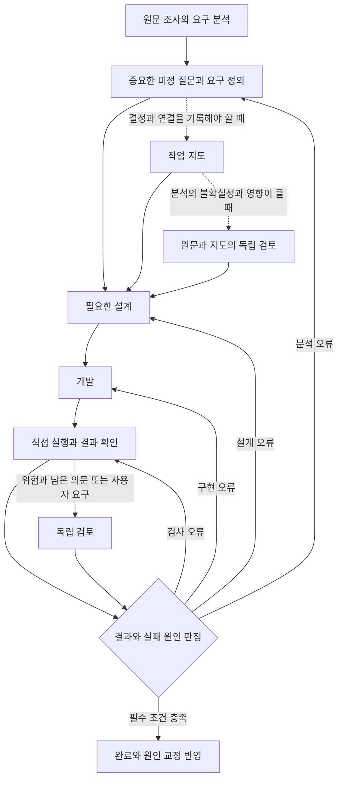

# 키트의 지향점과 설계 판단 기준

이 키트는 요구사항을 정확히 정의하고, 그 정의를 필요한 설계·개발·검증으로 연결하며, 실패의 원인을 고쳐 다음 작업의 판단까지 개선하는 흐름을 지향한다. 사용자가 결정해야 하는 애매함은 질문으로 풀고, 분석·설계·구현 중 어디에서 잘못됐는지 구분해 그 자리로 돌아간다.

문서는 얇게 유지하되 요구의 정의와 검증 근거는 충분해야 한다. 사용자의 개입과 비용을 줄이는 것은 이 흐름이 잘 작동한 결과다. 질문이나 문서가 짧아졌다는 사실만으로 개선을 판단하지 않는다.

## 비교와 실측을 반영한 운영 방향

기본 동작은 최소 기준으로 줄인다. 요구를 확인하고, 결과가 갈리는 중요한 미정을 묻고, 사용자가 정한 범위를 지키고, 완료 전에 실제 결과를 확인하는 원칙을 중심에 둔다. 지도·단계 스킬·독립 검토는 해당 작업의 결정과 연결을 유지하거나 구체적인 오류를 막는 데 필요할 때 선택한다.

아래는 앞으로 적용할 설계 기준이다. 이 문서 수정만으로 현재 설치되는 AGENTS.md·스킬의 실행 규칙이 바뀐 것은 아니다.

2026-11-05 사용자 결정(v3.1): 자연어 승인 판별 관문(approval-gate.py)과 그 훅을 없앤다. 요청 이해와 범위 판단은 AI 와 지침이, 파일 쓰기·명령의 실제 허용은 각 도구의 권한 설정·sandbox 가, 결과 확인은 검사·diff 검토가 맡는다. 훅은 도구 설정으로 지킬 수 없는 구체적 요구가 있을 때만 둔다(지금은 없음). 분명한 실행 요청은 그 자체가 승인이다. 아래 표의 관문 관련 항목은 그 전의 판단 기록이다.

### 세 구성 비교에서 관찰한 것

근거는 2026년 11월 4일 대화에서 사용자가 공유한 키트 없음·최소 기준·현재 상세 키트의 비교 요약이다. 최소 기준은 지침 4줄과 승인 관문이다. 각 구성은 사례당 2회 실행됐으며, 이번 문서 수정에서는 원시 기록을 다시 판정하지 않았다.

| 관찰 항목 | 공유된 결과 | 설계에 반영할 판단 |
| --- | --- | --- |
| 미정을 묻는 Codex 사례 5종 | 키트 없음은 각 0/2, 최소 기준은 각 2/2, 상세 키트도 측정한 항목 모두 통과 | 짧은 작업의 기본 경로는 최소 기준으로 충분할 가능성이 높다. |
| 명시된 요청과 승인 | 최소 기준 2/2·96초, 상세 키트 2/2·230초 | 결과가 같은데 늘어난 절차는 기본 경로에서 걷어낼 근거가 있다. |
| 정정 뒤 승인과 구현 2종 | 최소 기준 81~94초, 상세 키트 227~271초. 양쪽 모두 구현했으나 결과는 검토 필요 | 완료 품질이 같다고 단정하지 않되, 상세 경로의 추가 비용은 줄일 대상이다. |
| 독립 검토 필수 계약 변경 | 최소 기준 0/2, 상세 키트 2/2로 두 모델에서 차이 | 검토 수행 조건을 만족한 차이다. 실제 결함 탐지나 결과 정확성의 우위는 입증하지 않았다. |
| 숨긴 명시 사례와 답 반영 사례 | 세 구성 모두 통과, 상세 키트는 1.3~2배의 시간 | 이미 명확한 요구에 상세 절차를 자동으로 붙일 근거가 약하다. |
| Codex 질문 순서 | 세 구성 모두 1/2 | 이번 변경의 효과를 관찰하지 못했다. 문장으로 개선할 수 없거나 실행 환경이 원인이라고 확정하지 않는다. |

사례는 모두 3턴 이하의 짧은 작업이다. 적은 반복에서 관찰한 경향으로 기본값을 단순화하되, 여러 세션의 인계·복잡한 요구 분석·지도의 추가 가치까지 없다고 결론 내리지 않는다. 추가 가치가 관찰되지 않은 것과 불필요함이 입증된 것은 구별한다.

### 기본과 선택을 나누는 기준

| 수단 | 기본 위치 | 선택 기준과 예 |
| --- | --- | --- |
| 최소 지침 | 기본 유지 | 중요한 미정을 묻고 사용자가 정한 범위 안에서 수행하며 확인한 결과를 보고한다. 쓰기 허용은 도구 권한 설정이 맡는다(v3.1 에서 관문 제거). |
| 작업 지도 | 선택 | 여러 결정·의존 관계·상충하는 근거·인계를 대화만으로 유지하기 어려울 때 쓴다. 짧은 일도 정책이 얽히면 대상이며, 오래 걸려도 명확한 반복 작업이면 별도 지도가 불필요할 수 있다. |
| 분석의 독립 검토 | 선택 | 원문과 요구 정의의 일치에 중요한 불확실성이 있고, 잘못 정의한 채 개발할 때 재작업이나 실패 영향이 큰 경우 먼저 검토한다. |
| 결과의 독립 검토 | 선택하되 필수 보장 유지 | 외부 약속의 호환성, 권한 판단, 데이터 삭제·이전 등에서 깨질 수 있는 보장과 직접 검사만으로 남는 의문을 특정한다. 단순히 데이터에 닿는다는 이유로 일반 항목 수정까지 검토하지 않는다. 검증 기준 약화와 사용자의 검토 요구는 별도 검토 대상으로 유지한다. |
| wf-design·wf-implement 상세 절차 | 기본 자동 호출에서 제외하는 방향 | 필요한 판단을 최소 지침·선택 지도·전문 스킬에 맡길 수 있는지 확인하고 중복을 교체·삭제한다. 짧은 사례 결과만으로 복잡한 작업에서의 역할까지 일괄 삭제하지 않는다. |
| 실패 교정 | 기본 유지 | 확인된 원인을 가진 코드·검사·지침을 고치고 원래 실패와 영향을 다시 확인한다. |

절차를 선택할 때는 “이 작업에서 어떤 누락이나 잘못된 결정을 막으려는가”를 구체적으로 설명할 수 있어야 한다. 지도 작성 횟수나 검토 호출 횟수 자체를 목표로 삼지 않는다. 직접 검사는 모든 작업에서 남기고, 필수 검토를 못 한 상태는 검토가 필요 없어 생략한 상태와 구별한다.

## 요구 정의부터 원인 교정까지의 흐름

실선은 기본 흐름이고 점선은 조건에 따라 선택하는 경로다. 검토가 필수인 작업은 검토 결과까지 받아야 완료할 수 있다. 분석·설계·개발의 책임은 유지하면서 그 책임을 수행하는 문서와 단계의 수는 줄인다.

### 요구 분석과 질문

분석은 사용자의 말을 실행 항목으로 옮기기 전에, 원하는 결과·대상·범위·제약·유지할 기존 보장·완료 조건을 이해하는 일이다. 저장소에서 조사할 수 있는 사실은 먼저 확인한다. 요청에 없는 정책을 기존 구현이나 에이전트의 선호로 확정하지 않는다.

미정은 이미 근거가 있는 것, 조사로 정할 수 있는 것, 사용자가 결정해야 하는 것으로 구분한다. 결과·범위·권한·완료 기준이 갈리는데 근거가 없으면 추천 이유와 선택에 따른 결과 차이를 붙여 묻는다. 서로 독립인 질문은 묶고, 앞선 답에 따라 달라지는 질문은 그 답을 받은 뒤 판단한다.

요구 정의가 끝났다는 것은 다음 담당자가 사용자가 원하는 결과를 다시 추측하지 않아도 된다는 뜻이다. 중요한 미정을 숨기지 않고, 사용자가 정한 결과와 에이전트가 선택한 내부 구현을 구별할 수 있어야 한다. 질문의 종료는 횟수로 정하지 않고 지금 결정해야 할 사용자 몫이 해소됐는지로 판단한다.

### 작업 지도와 설계

작업 지도는 요청 원문에서 요구, 기대 결과, 설계 위치, 검사와 증거까지 따라갈 수 있게 연결한 기록이다. 지도 그림은 이 연결과 영향을 이해하는 데 도움이 될 때 사용한다. 그림이 있다는 사실보다 누락과 잘못된 연결을 발견할 수 있는지가 중요하다.

지도에는 요구별 근거와 기대 결과, 범위 밖, 유지할 기존 보장, 확인 방법을 담는다. 설계는 각 요구를 어느 책임과 변경 위치에서 실현할지 설명한다. 개발은 그 설계를 실제 동작에 연결한다. 작은 일은 같은 내용을 대화 몇 줄로 표현할 수 있고, 여러 턴에 걸치는 일은 하나의 지도를 기준으로 이어 간다.

사용자가 승인한 결과와 범위는 구현 방법과 구별한다. 결과가 같은 내부 선택은 에이전트가 정하되, 사용자에게 보이는 결과를 바꾸는 미정은 요구 정의로 돌려보낸다.

### 분석과 결과의 독립 검토

구현자가 만든 요구 목록과 시험이 서로 일치해도, 둘 다 원문을 잘못 이해했다면 검증을 통과할 수 있다. 따라서 독립 검토는 구현 결과뿐 아니라 요구 분석의 누락·왜곡·근거 없는 가정도 확인해야 한다. 사용자의 승인도 분석의 완전성이나 기술적 타당성을 자동으로 증명하지는 않는다.

독립 검토자는 분석·구현을 맡지 않은 다른 검토자다. 같은 모델의 하위 에이전트도 역할을 맡을 수 있지만 같은 오류를 반복할 가능성은 남는다. 원문·사용자 결정·외부 계약과 실제 결과를 근거로 판단하고, 구현자의 자기평가를 그대로 승인하지 않는다. 검토자는 사용자 대신 새 요구를 결정하지 않는다.

분석을 잘못한 채 개발할 위험이 크면 원문과 요구 정의를 먼저 독립 검토한다. 이 절차가 실제 누락을 줄이는지는 별도 사례로 확인한다. 개발 뒤에는 요구와 연결된 기존 보장이 실제로 충족되는지 확인한다. 직접 실행한 검사와 출력은 검토의 필수 근거이고, 독립 검토가 이를 대체하지 않는다. 반대로 구현자가 시험을 실행했다는 사실만으로 분석까지 타당하다고 결론 내리지 않는다.

검토는 합의한 결과와 연결된 영향에 집중한다. 지적은 어떤 요구가 깨지는지와 원문·파일 위치·재현 등 확인 가능한 근거를 포함해야 한다. 새로운 요구나 취향은 개선 제안으로 구별하고 현재 작업의 완료를 막는 결함과 섞지 않는다.

## 실패를 어느 자리에서 고칠 것인가

| 원인 | 판별할 질문과 예 | 교정할 자리 |
| --- | --- | --- |
| 요구 분석 | 원문을 빠뜨리거나 근거 없이 정책을 정했는가? 예: 보관 기간이 미정인데 30일로 정했다. | 원문 조사·질문·요구 정의와 지도. 사용자 결정이 필요하면 다시 묻는다. |
| 설계 | 요구는 맞지만 이를 실현하는 책임과 연결이 잘못됐는가? 예: 여러 저장 경로 중 하나에만 같은 보장을 적용했다. | 설계와 책임 배치, 영향을 받는 확인 경로. |
| 개발 | 설계는 맞지만 코드가 기대 동작을 구현하지 못했는가? 예: 합계에서 항목 하나가 누락됐다. | 구현 코드와 실패를 재현하는 검사. |
| 검사와 판정 | 틀린 결과를 통과시키거나 수행하지 않은 확인을 성공으로 셌는가? | 검사·실행 설정·관찰 도구·판정 기준. |
| 반복 판단과 실행 환경 | 같은 잘못된 선택을 지침이 유도하거나 승인·권한 집행이 실패했는가? | 해당 스킬 문장·소개문 또는 실행 도구의 권한·훅. |

원인은 처음부터 하나로 확정하지 않는다. 분석 오류와 구현 오류가 함께 있을 수 있으며, 확인되지 않은 원인을 모델의 습관으로 단정하지 않는다. 실패를 재현하고 원인을 고친 뒤 같은 실패와 연결된 영향을 다시 확인한다.

학습이 됐다는 것은 다음 작업에서 같은 원인으로 실패할 가능성을 줄였다는 뜻이다. 일반적인 주의 문장을 보태는 것으로 끝내지 않고, 원인을 가진 기존 코드·검사·지침을 교체한다. 실패 사례는 재현 가능한 시험 표본으로 남기고, 코드·시험에서 복구하기 어려운 결정 이유만 해당 기록에 반영한다.

## 얇게 유지할 문서와 충분히 남길 근거

매 세션 읽는 문서에는 판단 원칙과 실행 경계, 필요한 단계의 선택만 둔다. 세부 절차는 해당 스킬이 한 곳에서 관리하고 필요할 때 읽는다. 절차를 옮기면 기존 자리의 중복을 지운다.

작업별 지도는 그 작업의 요구와 판단에 필요한 만큼 구체적으로 쓴다. 상시 지침이 얇아야 한다는 이유로 요구나 검증 근거를 생략하지 않는다. 반대로 이미 코드·시험으로 확인되는 내용을 상시 지침에 반복하지 않는다.

문서 예산은 크기 증가를 막는 장치다. 원인을 고쳤다는 증거는 실패 재현과 수정 뒤의 재검증에서 나온다. 작업을 마치면 재사용할 결정을 그 관리 위치에 반영하고 임시 지도와 자료는 기존 정리 기준을 따른다.

## 참고 스킬과 비교해 선택할 기준

공식 스킬을 조사한 비교에서 가져올 것은 요구 정의·검토·교정에 기여하는 구체적인 방법이다. 아래의 근거는 2026년 11월 4일 조사 때 고정한 커밋이며, 플러그인 전체를 같은 과제로 실행해 우열을 낸 결과는 아니다.

| 참고 대상 | 가져올 판단 방법 | 이 키트에서의 범위 |
| --- | --- | --- |
| [Matt Pocock skills](https://github.com/mattpocock/skills/blob/4ae2317ddb22b046e26455e4f9c9b3aaaf62212d/skills/productivity/grilling/SKILL.md) | 선행 결정이 풀려 지금 답할 수 있는 질문을 묶고, 조사할 사실은 직접 확인한다. | 기존 질문 원칙을 다듬고 누락을 평가한다. 같은 규칙을 중복 추가하지 않는다. |
| [superpowers](https://github.com/obra/superpowers/blob/22f0b463e7a5e579904dd6211a520321035526f7/skills/brainstorming/SKILL.md) | 규모 있는 설계를 새 검토자에게 읽혀 계획에 필요한 미정을 찾는다. | 분석이 불확실한 작업에 개발 전 검토를 적용해 본다. 매 작업의 검토나 전체 절차를 기본값으로 복제하지 않는다. |
| [agent-skills](https://github.com/addyosmani/agent-skills/blob/301b02b12bff98e4688e6984af6556802322bbde/skills/spec-driven-development/SKILL.md) | 요구·책임·의존 관계·구현 순서와 확인 조건을 연결한다. | 필요할 때 하나의 지도에 연결을 표현한다. 문서 수보다 누락 발견과 최종 결과를 평가한다. |
| [ECC](https://github.com/affaan-m/ECC/blob/b38be6a7f6350964d59328b52f0624e1d1d552d1/skills/continuous-learning-v2/SKILL.md) | 프로젝트별 관찰과 학습 적용 범위를 구분한다. | 교정이 다음 세션에도 적용되는지 확인한다. 자동 기억과 규칙 축적 전체를 선행 조건으로 삼지 않는다. |
| [Ruflo](https://github.com/ruvnet/ruflo/blob/5f3dacc54b7279e39b172d6027d7989791448e2e/.agents/skills/sparc-methodology/SKILL.md) | 복잡한 작업의 요구·구조·개선·완료를 나누고 작은 명확한 일은 제외한다. | 복잡한 작업의 책임 구분을 참고한다. 협업·기억 운영 기능은 실제 병목이 확인될 때 검토한다. |
| [compound-engineering](https://github.com/EveryInc/compound-engineering-plugin/blob/a3bcedfc7136d5db2262c8339e514b6fb15b8f81/docs/solutions/skill-design/benchmark-review-peer-model-and-reasoning-tier.md) | 특정 검토 역할을 실제 결함으로 평가한다. | 검토 호출 여부에 더해 결함 탐지·잘못된 지적·교정 결과를 측정한다. |

유명세나 기능 수는 추가 절차를 채택할 근거가 아니다. 다른 프로젝트에도 행동 평가와 검토 성능 실측이 있으므로 시험량에서의 우위를 주장하지 않는다. 개인 작업에서는 하나의 작업 기준을 유지하고 필요한 전문 기법을 골라 쓰며, 동일한 결정권을 가진 상위 작업 흐름을 중복 적용하지 않는다.

## 현재 키트가 갖춘 것과 남은 차이

통합 구조(최소 기준 + 선택 안내 guide.md + 입력을 고정한 검토 도구)를 채택했다(v3.0 의 승인 관문은 v3.1 에서 제거). 장치가 있다는 사실과 실제 작업에서 효과가 있다는 사실은 구별한다.

| 지향점 | 현재 있는 장치 | 확인된 것 | 남은 차이(미확인 포함) |
| --- | --- | --- | --- |
| 기본은 최소 기준 | AGENTS.md 키트 영역(약 3.2KB): 미정 질문·분명한 실행 요청은 바로 수행·완료 전 요청 원문과 실제 결과 대조·원인 교정. 단계 스킬 자동 호출 없음 | v3.0 기준: 기본 경로 3사례×2회에서 최소 기준과 같은 결과, 명확한 작업에 지도·검토 자동 부착 0/6 | v3.1(관문 없음)의 묻기·바로 수행 균형은 evals 권한·요청 해석 사례 8개로 다시 잴 것. 시간(v3.0): 전체 평균 1.14배로 고정 기준(전체 평균 1.2배 이하) 통과. 버튼 사례 단독은 1.24배로 사례별 한도라면 미충족이다 |
| 애매함을 풀고 요구 정의 | AGENTS 기본 2, guide.md 「질문」 | 이전 3자 비교에서 최소 기준이 미정 질문 실패 5종을 막음 | Codex 질문 순서 사례 1/2 는 개선을 관찰하지 못함(원인 미확정) |
| 지도에서 설계와 개발로 연결 | guide.md 「작업 지도」(놓칠 위험으로 선택) | — | 복잡한 요구·여러 세션·인계에서의 효과는 미평가 |
| 분석 자체의 독립 검토(개발 전) | 없음. 검토 도구는 구현 뒤 변경을 본다 | — | 개발 전 분석 검토의 경로·시점이 없다 |
| 결과의 독립 검토 | guide.md 「독립 검토」, verify.py: 지도 `## 기준` 에 인용한 요청 원문(또는 사용자 글 그대로의 파일)·지도 기준·기준 커밋부터의 diff 를 검토자에게 넘김(원문이 없으면 입력 부족). 인용이 원문 그대로인지는 도구가 확인하지 못한다. 사용자 요구·기준 약화 때 필수, 확인 공백·큰 실패 영향 때 선택 | 결함 사례 6개(요구 누락·설계 오류·잘못된 검사 각 2) 모두 첫 검토에서 반환, 교정·재검토 뒤 실제 결과 6/6 수정. 정상 2개 불필요한 반환 0 | 같은 원문·계획을 받고 "원문과 대조해 직접 확인"을 지시받은 구현자도 6/6 수정 → 이 사례에서 검토의 추가 가치는 관찰되지 않음. 구현자가 스스로 만든 잘못된 가정을 유지하는 상황의 검토 가치는 미확인(시험 보류) |
| 원인 단계로 반환 | guide.md 「독립 검토」 4: 요구 정의·설계·코드·검사로 돌아감 | 실제 결과의 수정 6/6 | 잘못된 설계·판단 자체를 그 자리에서 고쳤는지는 채점하지 않았다. 원인 교정과 학습이 완료됐다고 주장하지 않는다 |
| 원인 교정을 통한 학습 | 원인 자리 교체 원칙, 실패 표본·전후 비교, 문서 예산 | — | 같은 원인의 재발 관찰은 아직 없다 |

가설(미확인): 요구 누락을 찾은 핵심은 별도 검토자보다 "요청 원문을 고정해 두고 완료 전에 대조하는 것"일 수 있다. 두 경로 모두 원문을 받았으므로, 이번 시험은 원문 대조를 지시받은 직접 확인만으로도 해당 결함을 고칠 수 있음을 보였을 뿐이다. 이에 따라 완료 전 원문 대조를 기본 확인에 명시했고, 독립 검토 조건의 추가 축소와 자기 실수 검토 시험은 보류했다.

## 다음 변경의 평가와 채택 기준

기본 경로 축소와 선택 절차의 가치 검증을 나누어 진행한다. 전자는 이번에 비용이 확인된 문제를 줄이는 작업이고, 후자는 아직 측정하지 않은 지향점을 확인하는 작업이다.

기본 경로는 미정 질문·승인·직접 확인의 기존 보장이 유지되는지 본다. 이미 명확한 요청에서 불필요한 지도·단계 호출·검토가 줄고 시간과 사용자 부담이 줄어드는지 확인한다. 검토가 필요한 사례의 호출 누락도 함께 본다. 짧은 사례의 빠른 재측정은 교정 확인에 쓰고, 적은 횟수의 무회귀를 일반적인 안전 보장으로 확대하지 않는다.

선택 절차는 다음 다섯 사례로 실제 추가 가치를 확인한다.

| 사례 | 통과에 필요한 결과 |
| --- | --- |
| 원문 요구가 지도와 코드에서 함께 누락 | 원문과 대조해 누락을 찾고 요구 정의로 돌아가 최종 결과에 반영한다. |
| 요구는 맞지만 설계가 기존 항목이나 다른 경로를 누락 | 설계의 잘못된 연결을 찾아 교정하고 영향을 다시 확인한다. |
| 요구와 설계는 맞지만 구현이 틀림 | 요구를 약화하지 않고 구현 결함을 재현·교정한다. (이번 결함 사례에는 따로 없음: 잘못된 검사 사례에 섞임) |
| 잘못된 검사도 구현과 같은 가정으로 통과 | 검사 통과를 완료 근거로 삼지 않고 실제 동작과 검사 모두 교정한다. |
| 정상적인 지도·설계·구현 | 새 요구나 취향을 결함으로 만들지 않고 검토를 끝낸다. |

여러 세션 사례에서는 승인 기준·사용자 결정·미정·남은 확인을 인계받은 담당자가 다시 추측하거나 같은 결정을 묻지 않고 이어 갈 수 있는지 확인한다. 학습은 새 세션에 표현과 상황을 바꾼 같은 실패를 주어 교정한 판단이 적용되는지 본다.

최소 기준을 추가 절차의 비교 대상으로 유지한다. 무엇이 개선돼야 채택하는지, 필수 보장과 허용할 비용은 실험 전에 정한다. 이전의 시간 1.2배 등 채택 조건을 바꾸려면 변경 이유와 적용할 새 실험을 명시하고, 기존 실패를 소급해 통과로 바꾸지 않는다.

원문과 최종 결과의 일치, 중요한 선택 누락, 잘못된 지적, 원인 자리 교정과 재발을 핵심 결과로 본다. 검토 수행 자체가 필수인 사례에서는 그 의무의 준수 여부도 별도로 판정하되, 절차 준수를 결과 품질의 향상으로 대신 세지 않는다. 호출 횟수·질문 수·첫 답 길이는 원인을 설명하는 보조 지표다.

## 개선을 채택하고 작업을 끝내는 기준

새 절차는 실제로 어떤 실패를 줄이는지, 기존 책임 중 무엇을 대체하는지, 어떻게 효과를 확인할지 설명할 수 있어야 한다. 효과가 없으면 되돌리고 차이가 불확실하면 새 문장을 계속 보태지 않는다.

필수 보장을 지키면서 요구 정의의 정확도와 최종 결과가 좋아지고, 원인 교정이 확인되면 개선의 근거가 된다. 같은 결과라면 더 짧고 관리할 것이 적은 구성을 남긴다. 비용을 받아들이려고 기준을 바꾸면 기존 기준의 미충족과 새 결정을 구별한다.

필요한 비교와 회귀 확인이 끝나면 이번 변경을 닫는다. 남은 실패는 재현 사례로 보존하고 실제 부담과 근거가 있을 때 다음 작업으로 다룬다. 확인되지 않은 원인마다 규칙을 더하는 일을 학습으로 취급하지 않는다.

이 방향은 문서에 반영한 설계 기준이며 기본 경로 축소·스킬 정리·검토 조건 변경의 구현 완료를 뜻하지 않는다. 실제 전환에서는 기존 필수 보장을 대조해 보존하고, 보장을 낮추는 변경은 별도 결정으로 다룬다.

현재 실행 규칙은 [AGENTS.md](../AGENTS.md), 단계 절차와 양식은 [스킬 안내](../.agents/skills/README.md), 진행 중인 설계와 실측은 [작업 지도](../work/kit-final/work.md)와 [evals](../evals/README.md)가 맡는다. 이 문서는 개발 방향을 판단할 때 읽으며 프로젝트에 설치하거나 매 세션 읽는 지침에 추가하지 않는다.
